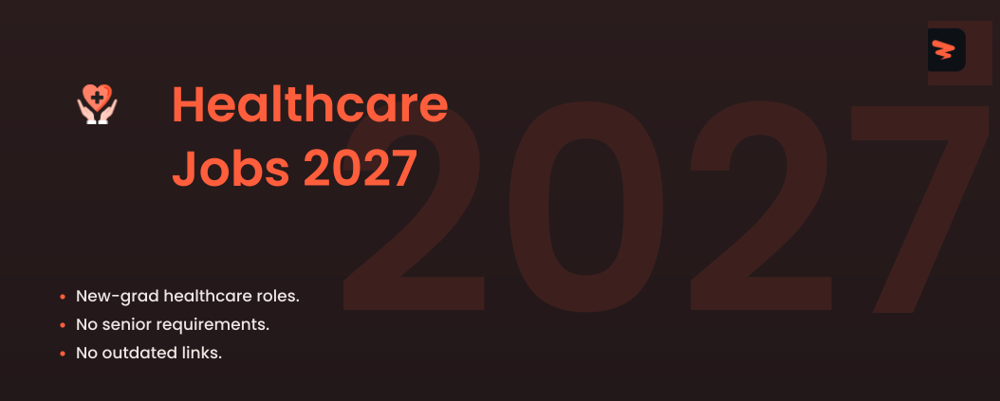

<!-- Cover -->

# Healthcare Jobs 2027

🚀 Healthcare and nursing jobs for new graduates, updated every 10 minutes.

  
  
  
  

---

## **Website & Autofill Extension**

Explore Zapply's website and check out:

- Our Chrome extension, which autofills job applications in seconds.
- A dedicated job board featuring the latest openings across various roles.
- User accounts with multiple profiles for different resume types and roles.
- Job application tracking with streaks and commitment awards.

Experience an advanced career journey with us! 🚀

  

## Explore Around

Connect and seek advice from a growing network of fellow students and new grads.

  
  &nbsp;&nbsp;
  

---

 

<h3>🏥 <strong>Nursing</strong></h3>

| Company | Role | Location | Posted | **Apply** |
|---------|------|----------|--------|----------|
| **Fresenius Medical Care** | Outpatient Registered Nurse - RN | Knoxville, TN | 46m |  |
| **Fresenius Medical Care** | Patient Care Technician - PCT | Aliquippa, PA | 46m |  |
| **Fresenius Medical Care** | Patient Care Technician - PCT | Benton Harbor, MI | 46m |  |
| **Elevance Health** | Behavioral Health Case Manager I - Western New York | NY LATHAM 15 PLAZA DR | 50m |  |
| **Elevance Health** | Family Care-Registered Nurse | 25 Locations | 50m |  |
| **Elevance Health** | Nurse Case Mgr II (RN) | 5 Locations | 50m |  |
| **Genentech** | 2027 Summer Intern - Translational Medicine Oncology | South San Francisco | 50m |  |
| **Amgen** | Grad Intern - Clinical Science, Late Stage Oncology (Summer 2027) | United States - Remote | 50m |  |
| **AstraZeneca** | Global Medical Affairs Intern | Gaithersburg - MD | 51m |  |
| **AstraZeneca** | Oncology Regulatory Affairs Intern | Gaithersburg - MD | 51m |  |
| **Highmark Health** | RN Nurse Clinician-Behavior Health-Robinson | Pittsburgh PA, 200 Quinn Drive | 1h |  |
| **Highmark Health** | RN Outpatient - AHN Primary Care Bloomfield - FT | Pittsburgh PA, 15224 | 1h |  |
| **Highmark Health** | Medical Assistant - Allegheny Valley Internal Medicine - Natrona Heights - FT | Natrona Heights PA, 15065, 1719... | 1h |  |
| **LabCorp** | Medical Lab Technician- Microbiology PRN | Nashville TN | 1h |  |
| **Cigna** | Hybrid Health Ediucator- Evernorth- FL | Orlando, FL | 1h |  |
| **Boys Town** | Registered Nurse- Psych Unit | Omaha, NE | 1h |  |
| **Intuitive** | Clinical Development Engineering Intern | Sunnyvale, CA | 6h |  |
| **Becton Dickinson** | Clinical Specialist - Government Accounts | Texas Houston | 21h |  |
| **CVS Health** | Pharmacy Intern | NY - Lewiston | 22h |  |
| **CVS Health** | Pharmacy Intern | NJ - Brick | 22h |  |
| **CVS Health** | Foreign Pharmacy Grad - International Pharmacy Intern | VA - Roanoke | 22h |  |
| **Kroger** | Pharmacy Intern | Bend, OR, United States | 23h |  |
| **Ascension** | Registered Nurse Neonatal ICU - FT Day | Wichita, KS | 23h |  |
| **Ascension** | Registered Nurse Operating Room | Elk Grove Village, IL | 23h |  |
| **Atlantic Health System** | Registered Nurse, Full-Time Days, 7a-7p, Operating Room, Atlantic Health Overlook Medical Center | Summit, NJ, United States | 23h |  |
| **Atlantic Health System** | Registered Nurse, Ambulatory, Part-Time (Tuesdays & Thursdays), Days, AMG- Cardiology,... | Hackettstown, NJ, United States | 23h |  |
| **Atlantic Health System** | Nursing Assistant, Per Diem, Days 7a- 3p, Operating Room, Atlantic Health Morristown Medical Center | Morristown, NJ, United States | 23h |  |
| **Ascension** | Registered Nurse NICU | Nashville, TN | 23h |  |
| **Zoetis** | Information Technology Intern – Veterinary Medicine R&D & Commercial Genetics | Kalamazoo - Kilgore Road | 1d |  |
| **Intuitive** | Clinical Research Engineering Intern | Sunnyvale, CA | 1d |  |
| **AbbVie** | Oncology Nurse Educator- Manchester/Boston/Hartford | Boston, MA | 1d |  |
| **AbbVie** | Oncology Nurse Educator- Manchester/Boston/Hartford | Manchester, NH | 1d |  |
| **AbbVie** | Oncology Nurse Educator - New York | New York, NY | 1d |  |
| **Cigna** | Oncology Nurse Case Manager - Remote | United States Work at Home | 1d |  |
| **Cigna** | LPN- Adverse Drug Events- Remote | United States Work at Home | 1d |  |
| **AstraZeneca** | Cell Therapy, Plan to Deliver Process Intern | – Tarzana – CA | 1d |  |
| **Wash U** | RN Clinical Nurse Coordinator (Hybrid) - Pediatric Neurology | Washington University Medical | 1d |  |
| **LabCorp** | Casual/PRN Float Phlebotomist | Olympia WA | 1d |  |
| **LabCorp** | Intern – Employee Wellbeing & Population Health | NC Durham 10 Moore Drive | 1d |  |
| **Cardinal Health** | PRN Hospital Pharmacy Technician | Sarasota, FL | 1d |  |
| **Kroger** | Pharmacy Intern | Phoenix, AZ, United States | 1d |  |
| **University of Miami** | Advanced Practice Registered Nurse (U) -  Critical Care  - Full Time | Miami, Florida | 1d |  |
| **University of Miami** | Registered Nurse 2, Specialty - Stem Cell Transplant - Intensive Care Unit, Full Time | Miami, Florida | 1d |  |
| **University of Miami** | Registered Nurse 2 - Oncology Specialty, Full Time | Miami, Florida | 1d |  |
| **Tenet Healthcare** | Registered Nurse (RN) - ER | San Ramon, CA, United States | 3d |  |
| **Genentech** | 2027 Summer Intern - Translational Pharmacokinetics & Pharmacodynamics (tPKPD): QSP Modeling in... | South San Francisco | 4d |  |
| **Conagra Brands** | Registered Nurse PRN - 3rd shift | Council Bluffs, Iowa | 4d |  |
| **Boys Town** | RTC-Registered Nurse | Omaha, NE | 4d |  |
| **Boys Town** | Inpatient Psychiatric Unit Social Worker-Therapist PT/PRN | Omaha, NE | 4d |  |
| **Vertex Pharmaceuticals** | Summer Intern 2027, Comparative Medicine | Boston, MA | Date unknown |  |
| **Intuitive** | Clinical Research Intern | Sunnyvale, CA | 4d |  |
| **University of Texas at Austin** | Temporary Front Desk Receptionist  - (Bilingual English/Spanish) - School of Nursing - (UTEMPS) | UT MAIN | 4d |  |
| **Wash U** | RN Research Nurse Coordinator l (Hybrid) - Radiology | Washington University Medical | 4d |  |
| **Wash U** | RN Research Nurse Coordinator l (Hybrid) - Neurology | Washington University Medical | 4d |  |
| **Convergent Research** | E11 Bio - Machine Learning Scientist I/II | Alameda, CA, Open to Remote | 4d |  |
| **Kroger** | Patient Care Technician | Franklin, IN, United States | 4d |  |
| **Tenet Healthcare** | Pharmacist Intern | Memphis, TN, United States | 4d |  |
| **Tenet Healthcare** | Registered Nurse (RN) - Cath Lab | Phoenix, AZ, United States | 4d |  |
| **Entegris** | Formulation Scientist, Intern - Summer 2027 | Aurora, IL | 5d |  |
| **Amgen** | Grad Intern - Computational Chemistry (summer 2027) | United States - Remote | 5d |  |
| **Amgen** | Grad Intern – Computational Chemistry (summer 2027) | United States - Remote | 5d |  |
| **Conagra Brands** | Registered Nurse PRN - 1st shift | Council Bluffs, Iowa | 5d |  |
| **Guidehouse** | Admission Coordinator   Overnight - 100% Onsite - ER | AL, Birmingham | 5d |  |
| **Medtronic** | Clinical Specialist, Peripheral Nerve Stimulation (PNS) - Northern Wisconsin | Green Bay, Wisconsin, United... | 5d |  |
| **GenScript** | Manager, LNP R&D | Seattle, Washington, United States | 5d |  |
| **Albertsons** | Supervisor China Express-SEATRT-NP | Puyallup, WA, United States | 5d |  |
| **MedVet** | Internal Medicine Veterinary Assistant | Worthington, Ohio | 5d |  |
| **MedVet** | Internal Medicine Veterinary Scheduling Coordinator | Worthington, Ohio | 5d |  |
| **Stryker** | Orthopedic Clinical Specialist - Joint Replacement - Bakersfield/Northern California | Bakersfield, California | 6d |  |
| **Bristol Myers Squibb** | 2027 Summer Internship: Law & Leadership Program | Princeton - NJ - US | 6d |  |
| **GenScript** | mRNA Associate Manufacturing Scientist I | Seattle, Washington, United States | 6d |  |
| **LLNL** | Physics-Informed Machine Learning - Postdoctoral Researcher | Livermore, CA | 6d |  |
| **HPE (University)** | HPE Labs - Systems Architecture Lab Research Associate Intern | Milpitas, California, United... | 6d |  |
| **Cardinal Health** | PRN Laboratory Technician | Casper, WY | 6d |  |
| **Abbott** | Occupational Health RN | United States - Minnesota -... | 6d |  |
| **Centene** | LPC, LCSW, or Behavioral Health RN Care Manager | Lubbock Texas79424 | 1w |  |
| **GenScript** | Lab Technician - Overnight Shift | Piscataway, New Jersey, United... | 1w |  |
| **Albertsons** | Assistant Deli Manager-0221TC-NP | Tacoma, WA, United States | 1w |  |
| **NREL** | Postdoctoral Researcher in Scientific Machine Learning and Cross-scale Predictive Modeling | Golden, CO | 1w |  |
| **Moderna** | Intern, Biobanking | Norwood, Massachusetts,... | 1w |  |
| **Genentech** | 2027 Summer Intern - In Vitro Safety & Neurotoxicology | South San Francisco | 1w |  |
| **University of Texas at Austin** | Registered Nurse (RN), Primary Care | AUSTIN, TX | 1w |  |
| **Cardinal Health** | PRN Hospital Pharmacy Technician | Enola- PAM Health Rehab Hosp of... | 1w |  |
| **Albertsons** | PT Pharmacy Technician-Smyrna, DE | Smyrna, DE, United States | 1w |  |
| **Centene** | LPC, LCSW, or Psychiatric RN, Behavioral Health Service Care Manager | Corpus Christi Texas78414 | 1w |  |
| **Zoetis** | Environment Health and Safety Intern | Kalamazoo - Downtown Portage Street | 1w |  |
| **Centene** | LPC, LCSW, or Behavioral Health RN - Pediatrics | Austin Texas78712 | 1w |  |
| **University System of New Hampshire** | Adjunct EMT Skills Lab Learning Assistant | University of New Hampshire – Main | 1w |  |
| **Globus Medical** | Neurophysiologist (Melbourne, FL) | Florida | 1w |  |
| **Medtronic** | Clinical Specialist, Peripheral Nerve Stimulation (PNS) - Northern Manhattan, NY | Manhattan, New York, United... | 1w |  |
| **Merck & Co.** | 2027 Future Talent Program – Pharmaceutical Operations Intern | New Jersey Rahway | 1w |  |
| **Becton Dickinson** | Clinical Specialist (Vascular Access RN) - Central Florida/Lakeland /Gainesville | Florida FIELD | 1w |  |
| **Merck & Co.** | 2027 Future Talent Program - Global Medical Affairs - Intern | USA - Pennsylvania - North Wales | 1w |  |
| **General Motors** | Registered Nurse - Occupational Health - PRN/per diem | Roanoke, Indiana, United States... | 1w |  |
| **Johnson & Johnson** | Oncology TR Scientist Intern | Spring House, Pennsylvania,... | 1w |  |
| **Johnson & Johnson** | Oncology Discovery Scientist Intern | Spring House, Pennsylvania,... | 1w |  |
| **Johnson & Johnson** | Oncology Clinical Scientist Intern | Spring House, Pennsylvania,... | 1w |  |
| **Bristol Myers Squibb** | Patient Safety Intern Summer 2027 | Princeton NJ US | 2w |  |
| **Bristol Myers Squibb** | Oncology Discovery Research Intern | Cambridge Crossing MA US | 2w |  |
| **Hormel Foods** | Veterinary Services Intern-Willmar, MN | Willmar, MN, United States | 2w |  |

Apply for more jobs at

<h3>🔬 <strong>Research & Laboratory</strong></h3>

| Company | Role | Location | Posted | **Apply** |
|---------|------|----------|--------|----------|
| **Fresenius Medical Care** | Clinical Educator | Decatur, AL | 46m |  |
| **Pfizer** | Senior Associate Scientist, ADC In Vivo Pharmacology | United States - California -... | 47m |  |
| **Pfizer** | Associate Scientist CID | United States - New York -... | 47m |  |
| **Merck & Co.** | Associate Scientist, Bio Process (on-site) | USA - Massachusetts - Boston | 48m |  |
| **Entegris** | Quality Lab Technician, 1st shift, 6 am to 2:30  pm | Aurora, IL | 50m |  |
| **Entegris** | QA Lab Technician I | San Luis Obispo, CA | 50m |  |
| **Amgen** | Medical Science Liaison - Obesity and Related Conditions - AZ | Arizona - Phoenix | 50m |  |
| **Boeing** | Test & Evaluation Lab Technician (Associate or Mid-Level) | USA - Berkeley, MO | 50m |  |
| **Air Liquide** | Laboratory Technician I | Taylor, TX | 50m |  |
| **Campbell Soup Company** | Associate Scientist, R&D | USA - NJ - Camden | 51m |  |
| **Aerospace Corporation** | Space Photovoltaics Test & Measurement Laboratory Technician | El Segundo, CA | 51m |  |
| **Zoetis** | Senior Associate Scientist (Pharmaceuticals/Small Molecules) | Kalamazoo - Downtown Portage Street | 1h |  |
| **Zoetis** | Senior Associate Scientist (Pharmaceuticals/Small Molecules) | Kalamazoo - Downtown Portage Street | 1h |  |
| **Zoetis** | Lab Technician | Lincoln | 1h |  |
| **Danaher** | Scientist I R&D | Fargo, North Dakota, United States | 1h |  |
| **Baxter International** | Research Scientist I - Material Science | Round Lake, Illinois | 1h |  |
| **Eurofins** | Laboratory Technician | Tinley Park, IL | 3h |  |
| **Eurofins** | Laboratory Support Associate Scientist | St. Louis, MO | 7h |  |
| **Eurofins** | Research Associate Scientist - Bioassay | St. Louis, MO | 7h |  |
| **Amgen** | Medical Science Liaison, NMOSD & gMG-Rare Disease - CO & UT | Colorado Denver | 22h |  |
| **Amazon.com Services LLC** | Applied Scientist II - AMZ10564086 | Seattle, WA | 23h |  |
| **Amazon.com Services LLC** | Data Scientist II, PXT Central Science | Arlington, VA | 23h |  |
| **Atlantic Health System** | Medical Laboratory Scientist, Full Time Days, Core Lab, Morristown, NJ | Morristown, NJ, United States | 23h |  |
| **Abbott** | Clinical Lab Scientist - Weekend PM | United States > Madison : 1... | 23h |  |
| **Abbott** | Clinical Lab Scientist I - Weekend PM | United States > Madison : 1... | 23h |  |
| **Abbott** | Clinical Lab Scientist - Weekend PM | United States > Madison : 1... | 23h |  |
| **Merck & Co.** | Associate Scientist, Combination Product Characterization & Verification (On-site) | USA - New Jersey - Rahway | 1d |  |
| **Merck & Co.** | Associate Scientist, Post Doc Fellow- Biologics Upstream Process Development | USA - New Jersey - Rahway | 1d |  |
| **Amgen** | Medical Science Liaison-Obesity and Related Conditions -San Diego | California - San Diego | 1d |  |
| **Boeing** | Laser/Optics/Mechanical Lab Technician (Associate, Mid-Level or Senior) | Kirtland AFB, NM | 1d |  |
| **Air Liquide** | Quality Control Lab Technician I | Upper Mount Bethel, PA -... | 1d |  |
| **Bristol Myers Squibb** | Senior Associate Scientist, Routine Assays | Cambridge - MA - US | 1d |  |
| **Aerospace Corporation** | 2027 Plasma Science Research Associate | El Segundo, CA | 1d |  |
| **Carnegie Mellon University** | Postdoctoral Research Associate - Mellon College of Science - Neuroscience Institute | Pittsburgh, PA | 1d |  |
| **Aerospace Corporation** | 2027 Research Associate - Space Photovoltaic Hardware/Device Testing | El Segundo, CA | 1d |  |
| **Iterative Health** | Clinical Research Coordinator I - New Albany, IN | New Albany, Indiana | 1d |  |
| **Iterative Health** | Clinical Research Coordinator I - New Albany, IN | New Albany, Indiana | 1d |  |
| **Iterative Health** | Clinical Research Coordinator II - Katy, TX | Katy, Texas | 1d |  |
| **AbbVie** | Laboratory Technician III | Waco, TX | 1d |  |
| **Fresenius Medical Care** | Clinical Educator | CA137 Kearny Mesa JV - Clinic | 1d |  |
| **Fresenius Medical Care** | Clinical Educator | AZ203 FMCNA Westgate Home - Clinic | 1d |  |
| **AstraZeneca** | Medical Science Liaison - (Hematology) - South Texas | Houston - TX | 1d |  |
| **Wash U** | Clinical Research Coordinator I (Data/Hybrid) - Medical Oncology | Washington University Medical | 1d |  |
| **Wash U** | Postdoctoral Research Associate - Radiology | Washington University Medical | 1d |  |
| **Wash U** | Research/Laboratory Technician II - Biology | Washington University Danforth | 1d |  |
| **Thermo Fisher Scientific** | FSP CRA I & CRA II - Oncology - Respiratory - Cardiovascular - Southeast region | Florida | 1d |  |
| **Thermo Fisher Scientific** | Scientist I | Florence, South Carolina, USA | 1d |  |
| **Thermo Fisher Scientific** | QC Scientist I | Florence, South Carolina, USA | 1d |  |
| **LabCorp** | Cytogenetic Technologist I, FISH | Torrance CA | 1d |  |
| **LabCorp** | Histotechnologist | Southfield MI | 1d |  |
| **LabCorp** | Operations Scientist I | Madison WI | 1d |  |
| **Cardinal Health** | Lab Technician | Birmingham PET, AL | 1d |  |
| **Cardinal Health** | Lab Technician (Nights) | East Hartford PET, CT | 1d |  |
| **Amazon.com Services LLC** | Applied Scientist II, Seller Fee Science | Seattle, WA | 1d |  |
| **Sherwin-Williams** | Quality - Lab Technician | Chester, SC, United States | 1d |  |
| **HPE (University)** | Hardware Lab Technician VI | Sunnyvale, California, United... | 2d |  |
| **HPE** | Hardware Lab Technician VI | Sunnyvale, California, United... | 2d |  |
| **BAE Systems** | Data Scientist II | Rockville, Maryland | 2d |  |
| **Ascension** | Clinical Research Coordinator Oncology | Mount Pleasant, WI | 3d |  |
| **Ascension** | Clinical Research Coordinator | Austin, TX | 3d |  |
| **Stryker** | Clinical Research Associate II | Mahwah, New Jersey | 4d |  |
| **Genentech** | Scientist 3, Translational Oncology | South San Francisco | 4d |  |
| **Bristol Myers Squibb** | Senior Associate Scientist | Princeton - NJ - US | 4d |  |
| **Bristol Myers Squibb** | Associate Scientist, Pilot Plant | Devens - MA - US | 4d |  |
| **Northeastern University** | Postdoctoral Research Associate | Burlington, MA | 4d |  |
| **Danaher** | Laboratory Technician | San Jose, California, United States | 4d |  |
| **Carnegie Mellon University** | Postdoctoral Research Associate - College of Engineering - Department of Mechanical Engineering | Pittsburgh, PA | 4d |  |
| **GenScript** | Quality Control (QC) Associate Scientist | Piscataway, New Jersey, United... | 4d |  |
| **University of Texas at Austin** | Build Lab Technician, School of Architecture | UT MAIN | 4d |  |
| **Guidehouse** | Data Scientist II | VA, Norfolk | 4d |  |
| **Baxter International** | Quality Lab Technician - 1st Shift | Cleveland, Mississippi | 4d |  |
| **AstraZeneca** | Medical Science Liaison - (Hematology) - N TX/CO/NM | St Louis, MO | 4d |  |
| **Boeing** | Test and Evaluation Lab Technicians (Associate) | USA - Berkeley, MO | 4d |  |
| **RTX** | Manufacturing Lab Technician - Electronics Test - 2nd Shift (Onsite) | IA-CEDAR RAPIDS | 4d |  |
| **Atlantic Health System** | Medical Laboratory Technician - Per Diem, Days / Evenings - Atlantic Advanced Urgent Care - Clark | Clark, NJ, United States | 4d |  |
| **Tenet Healthcare** | Clinical Educator - Perinatal | Harlingen, TX, United States | 4d |  |
| **Tenet Healthcare** | Medical Lab Scientist (MLS) | AZ, United States | 4d |  |
| **Danaher** | Laboratory Technician | San Jose, California | 4d |  |
| **Personalis** | Research Associate 2, Operations Sustaining | Fremont, CA | 5d |  |
| **Pfizer** | Senior Associate Scientist - Chemistry, Analytical R&D | United States - Connecticut -... | 5d |  |
| **Carnegie Mellon University** | Postdoctoral Research Associate - College of Engineering - Department of Mechanical Engineering | Pittsburgh, PA | 5d |  |
| **University of Texas at Austin** | Clinical Research Coordinator | AUSTIN, TX | 5d |  |
| **AbbVie** | Scientist II - Bioprocess Cell Culture Development | South San Francisco, CA | 5d |  |
| **Johnson & Johnson** | Medical Science Liaison, Neuroimmunology - South | Georgia Any City | 5d |  |
| **Johnson & Johnson** | Medical Science Liaison, Neuroimmunology - Great Plains | Minnesota Any City | 5d |  |
| **Amazon Web Services, Inc.** | Applied Scientist II, AWS Applied Data Science Labs | Seattle, WA | 5d |  |
| **Sherwin-Williams** | Lab Technician QC - Temporary Position - Gap Shift | Chicago, IL, United States | 5d |  |
| **Tenet Healthcare** | Medical Lab Scientist (MLS) | Buckeye, AZ, United States | 5d |  |
| **BAE Systems** | FAST Labs RF Scientist I or II | Merrimack, New Hampshire | 5d |  |
| **University of Miami** | Clinical Research Nurse 2 | Deerfield Beach, Florida | 5d |  |
| **University of Miami** | Clinical Trials Activation Analyst 3 | Miami, Florida | 5d |  |
| **University of Miami** | Manager, Clinical Trials Activation | Miami, Florida | 5d |  |
| **AeroVironment** | Biochemistry Laboratory Technician | WPAFB | 6d |  |
| **AbbVie** | Associate Scientist II - Biologics Drug Product Development | San Francisco, CA | 6d |  |
| **Flagship Pioneering** | Scientist, Cellular Immunology and Inflammation | Cambridge, MA USA | 6d |  |
| **Johnson & Johnson** | Experienced Scientist, Proteomics | Cambridge, Massachusetts,... | 6d |  |
| **AstraZeneca** | MS&T Process Associate Scientist | Frederick - MD | 6d |  |
| **Cardinal Health** | Laboratory Technician | Houston PET, TX | 6d |  |
| **Sherwin-Williams** | Quality Control Lab Technician - 2nd Shift | Garland, TX, United States | 6d |  |
| **Illinois Tool Works** | Laboratory Technician | Appleton, Wisconsin | 6d |  |

Apply for more jobs at

<h3>💼 <strong>Business & Operations</strong></h3>

| Company | Role | Location | Posted | **Apply** |
|---------|------|----------|--------|----------|
| **Elevance Health** | Prior Authorization Pharmacy Technician II - CarelonRx | 5 Locations | 50m |  |
| **Elevance Health** | Access Mental Health Customer Care Rep III | CT-ROCKY HILL | 50m |  |
| **Abbott** | Clinical Specialist - Pasadena, CA | United States California | 1h |  |
| **Abbott** | Key Account Clinical Specialist | United States - Massachusetts -... | 1h |  |
| **Highmark Health** | Patient Access Coordinator I/Emergency Department - AHN St. Vincent - Full time - Rotating Shifts | Erie PA, 16502 | 1h |  |
| **Highmark Health** | Patient Access Coordinator II - Fed North - Full time - Rotating Shifts | Pittsburgh PA, 15212 | 1h |  |
| **Highmark Health** | Patient Access Coordinator I - AHN Wexford - Full time - Rotating Shifts | Wexford PA, 12311 Perry... | 1h |  |
| **Guidehouse** | Financial Counselor | AL, Birmingham | 1h |  |
| **Globus Medical** | Associate Spine Specialist (Parkersburg + Charleston, WV) | West Virginia | 1h |  |
| **Boston Scientific** | Clinical Specialist   Urology - Prosthetic Urology   Knoxville, TN | Knoxville US-TN, United States... | 4h |  |
| **Boston Scientific** | Clinical Specialist   Urology - Sacral Neuromodulation   New Jersey | Northern US-NJ, United States ... | 5h |  |
| **Atlantic Health System** | Patient Access Representative I, Full Time, Days (10a-6p), Atlantic Health Morristown Medical Center | Morristown, NJ, United States | 23h |  |
| **Atlantic Health System** | Reg Respiratory Therapist - Atlantic Health Morristown Medical Center-Per Diem Nights | Morristown, NJ, United States | 23h |  |
| **Oracle** | Associate Consultant - Behavioral Health | United States | 23h |  |
| **Stryker** | Field Clinical Specialist - Birmingham, AL - Peripheral Vascular | Birmingham, Alabama | 1d |  |
| **Stryker** | Field Clinical Specialist - Tucson, AZ - Peripheral Vascular | Tucson, Arizona | 1d |  |
| **Globus Medical** | Associate Spine Specialist (Tampa North, FL) | Florida | 1d |  |
| **Boston Scientific** | Clinical Specialist, IVS - Pensacola/Tallahassee, FL | Pensacola/Panama City US-FL,... | 1d |  |
| **CVS Health** | Clinical Case Manager, Behavioral Health (Remote) | PA Work from home | 1d |  |
| **CVS Health** | Pharmacy Technician - Prior Authorization - Work From Home Arizona | AZ - Work from home | 1d |  |
| **Medtronic** | Clinical Specialist, CRM- Greater Boston | Boston, Massachusetts, United... | 1d |  |
| **Medtronic** | Clinical Specialist, CRM - West Chester, NY | New York, New York, United... | 1d |  |
| **Medtronic** | Cardiac Rhythm Management Associate Clinical Specialist - Columbia, SC | Columbia, South Carolina,... | 1d |  |
| **Atlantic Health System** | Patient Access Representative I, Per Diem, Variable Shifts, Atlantic Health Overlook Medical Center | Summit, NJ, United States | 1d |  |
| **Ascension** | Occupational Therapist | Manhattan, KS | 1d |  |
| **Ascension** | Physical Therapist Assistant | Tulsa, OK | 1d |  |
| **Ascension** | Physical Therapist Acute | Hoffman Estates, IL | 1d |  |
| **CVS Health** | SIU Medical & Behavioral Health Coding Analyst | Work At Home Missouri | 3d |  |
| **Hilton** | Massage Therapist (Part-Time) - Waldorf Astoria Monarch Beach Resort and Club | Dana Point, CA, United States | 3d |  |
| **Stryker** | Clinical Specialist, Joint Replacement - Cape Girardeau, MO | Cape Girardeau, Missouri | 4d |  |
| **Boys Town** | Psychiatric Technician | Omaha, NE | 4d |  |
| **Abbott** | Clinical Specialist, Cardiac Rhythm Management - San Luis Obispo, CA | United States - California -... | 4d |  |
| **Guidehouse** | Team Lead - Healthcare - Physician Claims | TX Lewisville | 4d |  |
| **Guidehouse** | Team Lead - Healthcare - Physician Claims | TX Lewisville | 4d |  |
| **Leidos** | Military Family Life Counselor - Eielson, AK | Eielson AFB, AK | 4d |  |
| **Leidos** | MFLC Counselor: Short Term or As Needed Coverage, Fort Polk, LA | 11384 Fort Johnson LA Home | 4d |  |
| **Hilton** | Massage Therapist (Part Time) - Hilton Waikoloa Village | Waikoloa, HI, United States | 4d |  |
| **Hilton** | Massage Therapist (Seasonal, Part-Time) - Waldorf Astoria Park City | Park City, UT, United States | 4d |  |
| **Tenet Healthcare** | Physical Therapist for BHS Physicians Network | El Paso, TX, United States | 4d |  |
| **University of Miami** | Patient Access Representative-1 - Deerfield Beach, FL | Deerfield Beach, Florida | 4d |  |
| **Boys Town** | Social Services Behavior Counselor | North Platte, NE | 5d |  |
| **Elevance Health** | Behavioral Health Customer Care Representative I | PA-SEVEN FIELDS | 6d |  |
| **Boys Town** | Licensed Youth Therapist | Omaha, NE | 6d |  |
| **Leidos** | Military Family Life Counselor - FE Warren, WY | Cheyenne, WY | 6d |  |
| **Tenet Healthcare** | Respiratory Therapist (RT) | San Antonio, TX, United States | 6d |  |
| **Tenet Healthcare** | Physical Therapist | San Ramon, CA, United States | 6d |  |
| **University of Miami** | Patient Access Representative 3 (On-Site) - Doral Clinic | Doral, Florida | 6d |  |
| **University of Miami** | Patient Access Representative 3- Doral | Doral, Florida | 6d |  |
| **Globus Medical** | Associate Spine Specialist (Louisville, KY) | Kentucky | 1w |  |
| **Becton Dickinson** | Clinical Specialist - Raleigh, NC | GA Covington BMD | 1w |  |
| **Amgen** | Field Medical Onboarding & Capability Development, US FME | United States - Remote | 1w |  |
| **Philips** | Sales Support, Clinical Specialist - Cardiac Solutions Image Guided Therapy Devices (Boston, MA) | Boston, Massachusetts, United... | 1w |  |
| **Baxter International** | Acute Care Clinical Specialist, New England Territory) | New York, NY | 1w |  |
| **Wash U** | Clinical Specialist PT/OT (Hybird/Part-Time) - Neurology | Washington University Medical | 1w |  |
| **SpaceX** | Environmental Health & Safety Specialist (Paramedic) | Long Beach, CA | 3w |  |
| **Included Health** | Mental Health Therapist | Texas | 3w |  |
| **Included Health** | Mental Health Therapist | Virginia | 3w |  |
| **Included Health** | Mental Health Therapist | Oregon | 3w |  |
| **Ro** | Associate Manager, Clinical Claims | New York, NY or Remote | 1mo |  |
| **SpaceX** | Environmental Health & Safety Specialist (Paramedic) | Cape Canaveral, FL | 2026-09-03 |  |

Apply for more jobs at

<h3>⚕️ <strong>General Healthcare & Clinical</strong></h3>

| Company | Role | Location | Posted | **Apply** |
|---------|------|----------|--------|----------|
| **Fresenius Medical Care** | Clinical Administrative Assistant | State College, PA | 46m |  |
| **Fresenius Medical Care** | Interventional Radiology Technologist Per Diem | Denver, CO | 46m |  |
| **Fresenius Medical Care** | Interventional Radiology Technologist | Denver, CO | 46m |  |
| **Stryker** | OnSite Specialist - Spartanburg, SC | Spartanburg, South Carolina | 46m |  |
| **Thermo Fisher Scientific** | Drug Safety Associate | Remote, North Carolina, USA | 47m |  |
| **Pfizer** | Cardiovascular Specialist, Health and Science Professional – Philadelphia SW, PA | United States Pennsylvania | 47m |  |
| **Pfizer** | Lab Analyst | United States - Kansas - McPherson | 47m |  |
| **Merck & Co.** | Associate Specialist, Clinical Data Management - Hybrid | New Jersey Rahway | 48m |  |
| **Johnson & Johnson** | Executive Area Business Specialist, Immunology (Tampa, FL) - Johnson & Johnson Innovative Medicine | Tampa, Florida, United States... | 48m |  |
| **Moderna** | Specialist, Quality Control | Marlborough, Massachusetts, Quality | 48m |  |
| **LabCorp** | Phlebotomist | Saint Charles MO | 48m |  |
| **LabCorp** | Phlebotomist | Phoenix AZ | 48m |  |
| **LabCorp** | Medical Laboratory Technologist - Generalist | USA  - WI - Mequon | 48m |  |
| **Medtronic** | Field Inventory Analyst Phase Wild West District - Austin, TX | Austin, Texas, United States of... | 48m |  |
| **Medtronic** | Field Service Engineer III - Cardiovascular (Seattle, WA) | State of Washington, United... | 48m |  |
| **Medtronic** | Extrusion Operator III | Beverly, Massachusetts, United... | 48m |  |
| **CVS Health** | Pharmacy Technician | NJ - Cherry Hill | 50m |  |
| **CVS Health** | Pharmacy Technician | PA - State College | 50m |  |
| **CVS Health** | Pharmacy Technician | TX - Katy | 50m |  |
| **Elevance Health** | Field Advanced Practice Provider - Home Health | IN-INDIANAPOLIS | 50m |  |
| **Elevance Health** | Nurse Care Manager I (Nclex) | 2 Locations | 50m |  |
| **Elevance Health** | Field Advanced Practice Provider | 3 Locations | 50m |  |
| **Amgen** | Patient Access Liaison - KRYSTEXXA, New Mexico/ El Paso | New Mexico Albuquerque | 50m |  |
| **Amgen** | Patient Access Liaison - Krystexxa - Jacksonville, FL (Rare Disease) | Florida Jacksonville | 50m |  |
| **Amgen** | Field Reimbursement Manager- Detroit, MI | Michigan - Detroit | 50m |  |
| **Oscar Health** | Physician - Virtual Urgent Care (Part-Time) | Remote (Tennessee) | 1h |  |
| **Abbott** | Associate Clinical Information Analyst | United States - California -... | 1h |  |
| **Abbott** | Clinical Associate | United States - California -... | 1h |  |
| **University System of New Hampshire** | Certified Veterinary Technician (CVT) | University of New Hampshire – Main | 1h |  |
| **Wash U** | Ultrasound Sonographer (Part-Time) - Obstetrics and Gynecology | Washington University Medical | 1h |  |
| **Wash U** | Medical Assistant II  - FPP Ambulatory Cancer Building | St. Louis, MO | 1h |  |
| **Wash U** | Patient Care Associate II - Faculty Practice Plan | St. Louis, MO | 1h |  |
| **Northeastern University** | Zelevinsky Postdoctoral Fellow | Boston, MA | 1h |  |
| **Highmark Health** | Supervisor, Patient Access - AGH - Full time -  Day Shift | Pittsburgh PA, 15212 | 1h |  |
| **Highmark Health** | Advanced Emergency Medical Technician / AEMT - Medical Transport | Grove City PA, 16127, 631 N... | 1h |  |
| **Highmark Health** | Social Worker - Clinically Integrated Network - South Hills | Pittsburgh PA, 15222, FAP, 5th... | 1h |  |
| **Guidehouse** | Research Nurse | MD, Bethesda | 1h |  |
| **Globus Medical** | Entry Level Associate Neurophysiologist (Columbus, OH) | Ohio | 1h |  |
| **Cardinal Health** | Hospital Pharmacy Manager | Reno, NV | 1h |  |
| **Cardinal Health** | IOD Pharmacy Technician | La Jolla-cCARE, CA | 1h |  |
| **Cardinal Health** | Pharmacy Technician | Pittsburgh, PA | 1h |  |
| **Cigna** | Home Infusion Nurse, Per Diem - Accredo - Roswell, NM | Albuquerque, NM | 1h |  |
| **Boys Town** | Bilingual Speech-Language Pathologist (Research) | Omaha, NE | 1h |  |
| **Oscar Health** | Physician (3:00pm - 11:00pm ET) - Virtual Urgent Care | Remote (Texas) | 1h |  |
| **LLNL** | HPC Data Provenance – Postdoctoral Researcher | Livermore, CA | 1h |  |
| **Oscar Health** | Physician (Bilingual Spanish) - Virtual Urgent Care (Nights - 7 days on & 7 days off) | Remote (Florida) | 4h |  |
| **Intuitive** | da Vinci Specialist | Reno, NV | 4h |  |
| **AbbVie** | Clinical Account Executive - Kansas City, KS | Kansas City, KS | 5h |  |
| **AbbVie** | Specialist, Access and Reimbursement | North Chicago, IL | 6h |  |
| **AbbVie** | Field Reimbursement Manager | Atlanta, GA | 7h |  |
| **Johnson & Johnson** | Executive Oncology Area Business Specialist, Solid Tumor, GU  – New Jersey - Johnson & Johnson... | New Jersey Any City | 11h |  |
| **Johnson & Johnson** | Executive Oncology Area Business Specialist, Solid Tumor, GU - Atlanta -Johnson & Johnson... | Atlanta, Georgia, United States | 11h |  |
| **Boston Scientific** | Interventional Oncology Consultant - Charlotte | Charlotte US-NC, United States... | 18h |  |
| **AstraZeneca** | Patient Access Supervisor | Gaithersburg - MD | 19h |  |
| **Kroger** | Pharmacy Technician | Washington Court House, OH,... | 23h |  |
| **Kroger** | Pharmacy Technician | Loveland, OH, United States | 23h |  |
| **Kroger** | Pharmacy Technician | Centennial, CO, United States | 23h |  |
| **Albertsons** | Pharmacy Technician | El Paso, TX, United States | 23h |  |
| **Albertsons** | Pharmacy Technician | Billings, MT, United States | 23h |  |
| **Albertsons** | Pharmacy Technician | Soldotna, AK, United States | 23h |  |
| **University of Miami** | Medical Technologist 2 - Immunology and Histocompatibility Laboratory (IHL) | Miami, Florida | 23h |  |
| **Atlantic Health System** | Unit Associate, per diem 8-hours, Davino 1-Orthopedics, Atlantic Health Morristown Medical Center | Morristown, NJ, United States | 23h |  |
| **Atlantic Health System** | Certified Medical Assistant I, Full Time, Days, AMG Head Neck Surgery, Morristown NJ | Morristown, NJ, United States | 23h |  |
| **Atlantic Health System** | Secretary/Technician - Full Time, Days 7a-7p, Med/Oncology 3AB, Atlantic Health Overlook Medical... | Summit, NJ, United States | 23h |  |
| **Ascension** | Physiatry Physical Medicine Physician | Kokomo, IN | 23h |  |
| **Ascension** | Certified Medical Assistant Urgent Care | West Lake Hills, TX | 23h |  |
| **Ascension** | Echo Tech | Jacksonville, FL | 23h |  |
| **Abbott** | Technician I, Remote Care | Puerto Rico - Arecibo | 23h |  |
| **Stryker** | OnSite Specialist - Lewes, DE | Lewes, Delaware | 1d |  |
| **Centene** | Utilization Review Clinician - ABA | WA State | 1d |  |
| **Argonne National Laboratory** | Postdoctoral Appointee - Autonomous Discovery Boron Doped Diamond | Lemont, IL | 1d |  |
| **Aerospace Corporation** | Electromechanical Technician | El Segundo, CA | 1d |  |
| **Aerospace Corporation** | 2027 Cleanroom & Device Test Associate | El Segundo, CA | 1d |  |
| **Aerospace Corporation** | Electronics Technology Specialist PMP | El Segundo, CA | 1d |  |
| **Intuitive** | da Vinci Specialist | St. Louis, MO | 1d |  |
| **Iterative Health** | Research Assistant - San Marcos, TX | San Marcos, Texas | 1d |  |
| **Boston Scientific** | Patient Access Case Manager | Arden Hills US-MN, United... | 1d |  |
| **EVERSANA** | Quality Lab Analyst - NJ candidate required, No 3rd party candidates | Central, New Jersey | 1d |  |
| **LLNL** | Physical Metallurgy and Materials Processing - Postdoctoral Researcher | Livermore, CA | 1d |  |
| **LLNL** | Energetic Materials Experimentalist - Postdoctoral Researcher | Livermore, CA | 1d |  |
| **Guidehouse** | Patient Account Representative - Special Billing Team | AL, Birmingham | 1d |  |
| **Cigna** | Equipment Delivery Driver and Service Technician - Onsite | FL, Longwood (AHRE) | 1d |  |
| **Cigna** | Warehouse Associate - CuraScript SD | Memphis, TN | 1d |  |
| **AstraZeneca** | Oncology Account Specialist (Breast) - Spokane, WA | Spokane - WA | 1d |  |
| **Thermo Fisher Scientific** | Unity Lab Services - Inventory Management Specialist II | North Chicago, Illinois, USA | 1d |  |
| **Thermo Fisher Scientific** | FSP Contract Specialist | Remote, North Carolina, USA | 1d |  |
| **Hologic** | Oncology Account Specialist - Southeast | Orlando, FL, United States | 1d |  |
| **University of Miami** | Patient Navigator | Miami, Florida | 1d |  |
| **University of Miami** | Radiation Therapy Technologist 1 | Miami, Florida | 1d |  |
| **MedVet** | Veterinary Client Service Representative - Contingent | Worthington, Ohio | 1d |  |
| **15dc44c7** | CERTIFIED SURGICAL TECH- Days, call rotation | Robinson, IL | 3d |  |
| **90ee0c52** | Patient Access Resource Management Analyst | Creve Coeur, MO | 3d |  |
| **NREL** | Postdoctoral Researcher - Power Electronics | Golden, CO | 4d |  |
| **NREL** | Postdoctoral Researcher - Computational Protein Design | Golden, CO | 4d |  |
| **NREL** | Postdoctoral Researcher - Cell Free Biocatalysis | Golden, CO | 4d |  |
| **Stryker** | OnSite Specialist- FairFax, VA | District of Columbia, Washington | 4d |  |
| **Pfizer** | Cardiovascular Specialist, Health and Science Professional - Delray Beach, FL | United States - Florida - Remote | 4d |  |
| **ICF** | Field Ecologist or Biologist – Part-time (hourly) | Missouri Field | 4d |  |
| **Hims & Hers** | Laboratory Assistant | South Plainfield, New Jersey | 4d |  |
| **Northeastern University** | Postdoctoral Teaching Associate | Boston, MA | 4d |  |

Apply for more jobs at

---

### Live Job Boards

  
  &nbsp;&nbsp;
  
  &nbsp;&nbsp;
  

  
  &nbsp;&nbsp;
  
  &nbsp;&nbsp;
  

  
  &nbsp;&nbsp;
  
  &nbsp;&nbsp;
  

  

### Curated Internships

  
  &nbsp;&nbsp;
  
  &nbsp;&nbsp;
  

  
  &nbsp;&nbsp;
  

### Career Resources

  
  &nbsp;&nbsp;
  

---

Add new jobs to our listings keeping in mind the following:

- Located in the US.
- Create a new issue to submit different job positions.
- Update a job by submitting an issue with the job URL and required changes.

Our team reviews within 24-48 hours and approved jobs are added to the main list!

Questions? Create a miscellaneous issue, and we'll assist! 🙏

**🎯 10961 current opportunities from 136 companies**

**Found this helpful? Give it a ⭐ to support Zapply!**

*Not affiliated with any companies listed. All applications redirect to official career pages.*

---

## Data & Reuse

Job listings are public information provided by employers, who remain responsible for their accuracy. The compilation and the added data fields (skills, degree and visa estimates, tags) are by Zapply.

You may use, share, and build on this data, including for commercial purposes, as long as you:

- Link back to this repository as the source (followed link, no nofollow).
- Credit Zapply as the data source.
- Do not resubmit the listings to third-party job aggregators or feeds.
- Do not present Zapply enrichment fields as official employer statements; they are automated estimates provided as-is, without warranty.

You may use the name Zapply to attribute the data. Please do not use the Zapply logo or imply endorsement without written permission.

Questions or a different use? Open an issue. We say yes more often than not.

---

**Last Updated**: November 17, 2026

