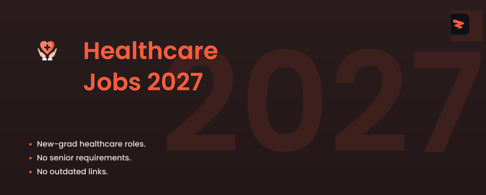

<!-- Cover -->

# Healthcare Jobs 2027

🚀 Healthcare and nursing jobs for new graduates, updated every 10 minutes.

  
  
  
  

---

## **Website & Autofill Extension**

Explore Zapply's website and check out:

- Our Chrome extension, which autofills job applications in seconds.
- A dedicated job board featuring the latest openings across various roles.
- User accounts with multiple profiles for different resume types and roles.
- Job application tracking with streaks and commitment awards.

Experience an advanced career journey with us! 🚀

  

## Explore Around

Connect and seek advice from a growing network of fellow students and new grads.

  
  &nbsp;&nbsp;
  

---

 

<h3>🏥 <strong>Nursing</strong></h3>

| Company | Role | Location | Posted | **Apply** |
|---------|------|----------|--------|----------|
| **Fresenius Medical Care** | Patient Care Technician - PCT | Dededo GU | 24m |  |
| **Highmark Health** | RN - Emergency Dept (Part-time) Canonsburg | Canonsburg PA, 15317 | 1h |  |
| **Highmark Health** | RN - Emergency Dept (Rotational) Canonsburg | Canonsburg PA, 15317 | 1h |  |
| **Highmark Health** | RN - Tele/Med Surg (Rotational) Canonsburg | Canonsburg PA, 15317 | 1h |  |
| **Abbott** | Registered Nurse - Patient Educator (PRN) Immediate Openings - Bronx, NY; Levittown, NY;... | United States - New York - Brooklyn | 3h |  |
| **CVS Health** | Telehealth Registered Nurse | TX - Work from home | 6h |  |
| **CVS Health** | Pharmacy Intern | WI - Milwaukee | 6h |  |
| **CVS Health** | Registered Nurse | NM - Albuquerque | 6h |  |
| **University of Miami** | Registered Nurse - Surgical Urology - Full Time | Miami, Florida | 10h |  |
| **Ascension** | Registered Nurse Clinic | Indianapolis, IN | 10h |  |
| **Ascension** | Registered Nurse Operating Room Traveler | TULSA, OK | 10h |  |
| **Tenet Healthcare** | Certified Nursing Assistant (CNA) - ER FT night | San Antonio, TX, United States | 10h |  |
| **Tenet Healthcare** | Registered Nurse (RN) - Recovery | New Braunfels, TX, United States | 10h |  |
| **Ascension** | Registered Nurse OR Market Float Pool | Austin, TX | 10h |  |
| **Fresenius Medical Care** | Outpatient Registered Nurse - RN | Joliet, IL | 14h |  |
| **Fresenius Medical Care** | Outpatient Registered Nurse - RN | Alexandria, LA | 1d |  |
| **Elevance Health** | Registered Nurse (PRN) Paragon Infusion Centers | TX-SAN ANTONIO | 1d |  |
| **Becton Dickinson** | Clinical Specialist (RN) - Fort Lauderdale/Palm Beach County, FL | Florida FIELD | 1d |  |
| **AstraZeneca** | Medical Science Liaison (Renal) - California South | Los Angeles - CA | 1d |  |
| **Johnson & Johnson** | Oncology TR Scientist Intern | Spring House, Pennsylvania,... | 1d |  |
| **Johnson & Johnson** | Oncology CPP Scientist Intern | Spring House, Pennsylvania,... | 1d |  |
| **Johnson & Johnson** | Oncology Preclinical Safety & TS Intern | Spring House, Pennsylvania,... | 1d |  |
| **Cardinal Health** | PRN Pharmacy Technician | San Antonio, TX | 1d |  |
| **Cigna** | Onsite Health Educator- Evernorth- Mulberry, FL | Clinic - The Mosaic Company -... | 1d |  |
| **Cigna** | Bilingual RN Health Coach - Evernorth - Arlington VA | Arlington, VA | 1d |  |
| **Cigna** | Bilingual RN Health Coach- North Carolina | North Carolina Work at Home | 1d |  |
| **Northeastern University** | Part Time Lecturer - School of Nursing, Charlotte, NC | Charlotte, NC | 1d |  |
| **Boys Town** | Registered Nurse (RN), Pediatrics | Omaha, NE | 1d |  |
| **LabCorp** | Phlebotomist - PRN | Smyrna DE | 1d |  |
| **LabCorp** | Phlebotomist PRN | Great Falls MT | 1d |  |
| **LabCorp** | Casual Float Phlebotomist/PRN | Anchorage AK | 1d |  |
| **Thermo Fisher Scientific** | Associate Sample Coordinator - 3rd Shift/Overnights (Wed - Sun) | Highland Heights, Kentucky, USA | 1d |  |
| **Abbott** | Registered Nurse - Patient Educator (PRN) Immediate Openings - Bloomington, IN | United States - Indiana -... | 1d |  |
| **Abbott** | Registered Nurse - Patient Educator (PRN) Immediate Openings - Petersburg, WV; | United States - West Virginia -... | 1d |  |
| **Amazon.com Services LLC** | Applied Scientist II, International and Emerging Stores Payments | Seattle, WA | 1d |  |
| **Atlantic Health System** | Patient Care Technician I - Full Time, Nights 7p-7a, General Surgery 9CD, Atlantic Health... | NJ, United States | 1d |  |
| **Atlantic Health System** | Registered Nurse - Full Time, Days 7am-7pm, Gagnon 4 Post TAVR, Atlantic Health Morristown... | Morristown, NJ, United States | 1d |  |
| **Atlantic Health System** | Registered Nurse, Ambulatory, Part-Time (Tuesdays & Thursdays), Days, AMG- Cardiology,... | Hackettstown, NJ, United States | 1d |  |
| **Kroger** | Patient Care Technician | Holland, OH, United States | 1d |  |
| **Kroger** | Patient Care Technician | Groveport, OH, United States | 1d |  |
| **Kroger** | Patient Care Technician | Westerville, OH, United States | 1d |  |
| **Tenet Healthcare** | Registered Nurse (RN) - Transfer Center | San Antonio, TX, United States | 1d |  |
| **University of Miami** | Registered Nurse 2 - Posner - Full-Time - Sylvester | Miami, Florida | 1d |  |
| **MedVet** | Internal Medicine Registered Veterinary Technician | Carmel, Indiana | 1d |  |
| **University of Miami** | Certified Nursing Assistant, Sylvester Stem Cell Transplant Unit, Per Diem | Miami, Florida | 1d |  |
| **MedVet** | Nursing Registered Veterinary Technician | Cleveland, Ohio | 1d |  |
| **Flagler Health** | Onsite - Licensed Practical Nurse (LPN) / Licensed Vocational Nurse (LVN)/ Medical Assistant (MA) | 200 W Monroe St, 2nd Floor,... | 1d |  |
| **Genentech** | Genentech Patient Foundation Navigator (Southern Stars & Northeast Region) | Columbus | 2d |  |
| **Wash U** | LPN - Urologic Surgery (CAM) | Washington University Medical | 2d |  |
| **Wash U** | LPN - Urologic Surgery | Washington University Medical | 2d |  |
| **Elevance Health** | Registered Nurse (PRN) – Paragon Infusion Centers | MO-KANSAS CITY, 8432 | 2d |  |
| **Elevance Health** | Registered Nurse (PRN) - Paragon Infusion Centers | TX-SAN ANTONIO | 2d |  |
| **Cardinal Health** | PRN Pharmacy Technician | South Point, OH | 2d |  |
| **Cardinal Health** | PRN Hospital Pharmacy Technician | Rio Grande City, TX | 2d |  |
| **Boys Town** | Registered Nurse- Psych Unit | Omaha, NE | 2d |  |
| **Boys Town** | Registered Nurse- Inpatient Medical Unit | Omaha, NE | 2d |  |
| **AbbVie** | California Comparative Medicine Training Specialist | Irvine, CA | 4d |  |
| **Wash U** | RN Clinical Nurse Coordinator  - Oncology - (Hybrid) | West County - St. Louis, MO | 5d |  |
| **Zoetis** | Regulatory CMC Data/Digital Internship | Kalamazoo - Downtown Portage Street | 5d |  |
| **Zoetis** | Laboratory Animal Veterinarian and Behavior Intern | Kalamazoo - Downtown Portage Street | 5d |  |
| **Thermo Fisher Scientific** | Associate Sample Coordinator - 2nd/Afternoons (Tuesday - Saturday) | Highland Heights, Kentucky, USA | 5d |  |
| **Eurofins** | Laboratory Technician I (Multiple Shifts) Eurofins Environment Testing Northern California - Air... | Folsom, CA | 5d |  |
| **ICF** | 2027 Summer Intern, Wildlife Biologist (Austin, TX) | Austin TX TX18 | 6d |  |
| **Gilead Sciences** | Intern - CFO - IT (Cell Therapy: Kite) | United States - California -... | 6d |  |
| **NREL** | Postdoctoral Researcher – Vision Machine Learning | Golden, CO | 6d |  |
| **MedVet** | Internal Medicine Veterinary Doctor Coordinator | New Orleans, Louisiana | 6d |  |
| **PDT Partners** | Summer 2027 Quantitative Research Intern - PhD/Postdoctoral | New York, NY | 6d |  |
| **Iterative Health** | Clinical Research Coordinator I - Port Arthur, TX - Phlebotomist, MA & LPNs welcome! | Port Arthur, TX | 6d |  |
| **Flagship Pioneering** | Serif Biomedicines: LNP Formulations Co-Op | Cambridge, MA USA | 6d |  |
| **Iterative Health** | Clinical Research Coordinator I - RN - Port Arthur & Beaumont, TX - Temp/ PRN Role | Port Arthur, TX | 6d |  |
| **Zoetis** | Environment Health and Safety Intern | Kalamazoo - Downtown Portage Street | 1w |  |
| **Danaher** | Clinical Research Lab RN | Irvine, California, United States | 1w |  |
| **Northeastern University** | Part Time Lecturer, School of Nursing, Clinical | Boston MA Main | 1w |  |
| **Danaher** | Clinical Research Lab RN | Irvine, California | 1w |  |
| **AbbVie** | Scientist I / II, Liquid Chromatography (LC), tLNP Analytical R&D | North Chicago, IL | 1w |  |
| **General Motors** | Occupational Health Registered Nurse | Wyoming, Michigan, United... | 1w |  |
| **Bristol Myers Squibb** | Senior Associate Scientist, Synthesis, RNA Process Sciences | Cambridge - MA - US | 1w |  |
| **Bristol Myers Squibb** | Associate Scientist, RNA Pilot Manufacturing | Cambridge - MA - US | 1w |  |
| **AstraZeneca** | Medical Science Liaison - Pipeline, Immunology (California) | Los Angeles, CA | 1w |  |
| **University of Texas at Austin** | Registered Nurse (RN), Medical Specialties | AUSTIN, TX | 1w |  |
| **Schweitzer Engineering Laboratories** | Registered Nurse | Washington - Pullman | Date unknown |  |
| **EVERSANA** | Cutaneous Oncology Clinical Nurse Educator - So Cal | Las Vegas, NV | 1w |  |
| **Becton Dickinson** | Clinical Specialist (Vascular Access RN) - Chicago | USA - Illinois - Chicago | 1w |  |
| **Northeastern University** | Part Time Lecturer, School of Nursing, Fall River, MA | Fall River, MA | 1w |  |
| **Moderna** | Intern, Oncology Biostatistics | Cambridge, Massachusetts,... | 1w |  |
| **Medtronic** | Clinical Specialist, Cranial & Spinal Technologies - Los Angeles / San Fernando Valley, CA | Los Angeles, California, United... | 1w |  |
| **Guidehouse** | Inpatient Pediatric Medical Coder | Remote | 1w |  |
| **General Motors** | Occupational Health Registered Nurse | Arlington, Texas, United States... | 1w |  |
| **University of Texas at Austin** | Registered Nurse (RN), Primary Care | AUSTIN, TX | 1w |  |
| **Varda Space** | Formulation Science Internship - Summer 2027 | El Segundo, California, United... | 1w |  |
| **HP Inc** | Chemical Engineer / Chemist Postdoctoral Intern | Corvallis, Oregon, United... | 2w |  |
| **Gilead Sciences** | Intern - Research - Oncology Biomarker - AI | United States - California -... | 2w |  |
| **Merck & Co.** | 2027 Future Talent Program – Biologics Process Research & Development Intern | New Jersey Rahway | 2w |  |
| **Gilead Sciences** | Intern - Research - Oncology Biomarker - AI | United States - California -... | 2w |  |
| **Albertsons** | Student Pharmacy Intern | Portland, OR, United States | 3w |  |
| **Merck & Co.** | 2027 Future Talent Program - Statistical Programmer - Intern | New Jersey Rahway | 3w |  |
| **Merck & Co.** | 2027 Future Talent Program - Payer and Health Systems - Intern | USA - Pennsylvania - North Wales | 3w |  |
| **Generac** | Lab Technician Intern | Santa Monica, CA  - USA | 1mo |  |
| **NREL** | Graduate Intern – Focused Ion Beam, Electron Microscopy, and Autonomous Characterization | Golden, CO | 1mo |  |
| **HNTB** | New Grad Scientist I - Summer 2027 - Central Division (For Current/Returning HNTB Interns Only) | Dallas, TX | 1mo |  |

Apply for more jobs at

<h3>🔬 <strong>Research & Laboratory</strong></h3>

| Company | Role | Location | Posted | **Apply** |
|---------|------|----------|--------|----------|
| **BillionToOne** | Reporting Clinical Laboratory Scientist (RCLS) | Union City, CA | 10h |  |
| **AbbVie** | Associate Scientist II, Digital Pathology & Image Analysis | Worcester, MA | 12h |  |
| **AbbVie** | Associate Scientist, Data II | North Chicago, IL | 12h |  |
| **AbbVie** | Scientist I - Computational Biology, Systems Immunology | Cambridge, MA | 12h |  |
| **Rocket Lab** | Data Scientist I | Tucson, AZ | 13h |  |
| **Iterative Health** | Clinical Research Coordinator I - Nurse | Tyler, TX | 18h |  |
| **Eurofins** | Laboratory Technician | Mequon, WI | 20h |  |
| **Wash U** | Clinical Research Study Assistant II - Psychiatry | Washington University Medical | 1d |  |
| **Fresenius Medical Care** | Clinical Educator | AZ062 Avondale JV - Clinic | 1d |  |
| **Fresenius Medical Care** | Clinical Educator | AZ005 FMCNA East Valley - Clinic | 1d |  |
| **Fresenius Medical Care** | Clinical Educator | AZ205 FMCNA Tangerine Crossing... | 1d |  |
| **Campbell Soup Company** | Job Posting Title Scientist I - Regulatory Affairs | USA - NJ - Camden | 1d |  |
| **Bristol Myers Squibb** | Senior Associate Scientist | Princeton - NJ - US | 1d |  |
| **Carrier Global** | Master Test Lab Technician | CAN01: Carrier-Syracuse, 6304... | 1d |  |
| **Becton Dickinson** | Medical Science Liaison | RI Warwick | 1d |  |
| **Becton Dickinson** | Medical Science Liaison | RI Warwick | 1d |  |
| **Becton Dickinson** | Laboratory Technician - A Shift | USA NE - Columbus | 1d |  |
| **Baxter International** | Research Scientist I | Round Lake, Illinois | 1d |  |
| **Baxter International** | Research Scientist I | Round Lake, Illinois | 1d |  |
| **Johnson & Johnson** | Medical Science Liaison – CAPLYTA (Neuroscience) - Ohio | Cleveland Ohio United States | 1d |  |
| **Amgen** | Medical Science Liaison - Obesity and Related Conditions - San Francisco, CA | California San Francisco | 1d |  |
| **Amgen** | Medical Science Liaison - Obesity and Related Conditions - OR, ID, MT, WY, WA | Oregon Portland | 1d |  |
| **Amgen** | Medical Science Liaison - Obesity and Related Conditions - Missouri | Missouri St Louis | 1d |  |
| **Momentive** | Quality Control Lab Technician | NY Waterford | 1d |  |
| **Merck & Co.** | Scientist, Downstream Vaccines and Advanced Biotechnologies (VAX) Process R&D | USA - Pennsylvania - West Point | 1d |  |
| **Merck & Co.** | Associate Scientist, Chemical Engineering Research & Development (Onsite) | USA - New Jersey - Rahway | 1d |  |
| **Merck & Co.** | Associate Scientist, Post Doc Fellow – Computational Chemistry | USA - Massachusetts - Boston | 1d |  |
| **LabCorp** | Medical Laboratory Scientist - $10,000.00 SIGN ON BONUS | Nashville TN | 1d |  |
| **LabCorp** | Clinical Laboratory Scientist - Consumer Genetics | San Diego CA | 1d |  |
| **LabCorp** | Clinical Lab Technician - Entry level, will train! | Calabasas Hills CA | 1d |  |
| **Boeing** | Test & Evaluation Lab Technician (Associate or Mid-Level) | USA - Berkeley, MO | 1d |  |
| **Thermo Fisher Scientific** | FSP - Scientist II - Small Molecule | Greenfield, Indiana, USA | 1d |  |
| **Thermo Fisher Scientific** | Associate Research Scientist - Immunochemistry | Richmond, Virginia, USA | 1d |  |
| **Thermo Fisher Scientific** | FSP Clinical Trial Coordinator II | Remote, North Carolina, USA | 1d |  |
| **Abbott** | Clinical Laboratory Scientist - Weekend AM | United States > Madison : 650... | 1d |  |
| **Eurofins** | In Vivo Laboratory Associate Scientist | San Diego, CA | 1d |  |
| **Hitachi** | Data Scientist I or II (MAD-BS-OR) | (HTA) NCP | 1d |  |
| **Eurofins** | Biopharmaceutical Chemist | Groton, CT | 1d |  |
| **Amazon.com Services LLC - A57** | Data Scientist II - AMZ10564077 | Sunnyvale, CA | 1d |  |
| **Ascendis Pharma** | Global Medical Scientist - Job ID: 2060 | Princeton, New Jersey | 1d |  |
| **WSP** | On Call Archaeology Lab Technician | Richmond, VA, United States | 1d |  |
| **Jensen Hughes** | Laboratory Technician - RDT+E | Baltimore, Maryland, United States | 1d |  |
| **LLNL** | Synthetic Chemistry Automation & Advanced Manufacturing - Postdoctoral Researcher | Livermore, CA | 1d |  |
| **Genentech** | Scientist 3 | San Diego | 2d |  |
| **Wash U** | Clinical Research Coordinator I - Radiation Oncology | Washington University Medical | 2d |  |
| **Campbell Soup Company** | Scientist I, R&D | USA - NJ - Camden | 2d |  |
| **Campbell Soup Company** | Scientist I, R&D | USA - NJ - Camden | 2d |  |
| **Pfizer** | Senior Associate Scientist, Upstream Process Development — Bioprocess Automation & Digitization | United States - Massachusetts -... | 2d |  |
| **Pfizer** | Associate Scientist-Vaccines | United States - New York -... | 2d |  |
| **AstraZeneca** | Medical Science Liaison -(Immunology) - Arizona/New Mexico/West Texas | Phoenix, AZ | 2d |  |
| **AstraZeneca** | Medical Science Liaison - (Asthma) - Pacific Northwest | Seattle, WA | 2d |  |
| **Cardinal Health** | Laboratory Technician | Tampa USF PET, FL | 2d |  |
| **Pentair** | Lab Technician | Manitowoc, WI | 2d |  |
| **Gilead Sciences** | Medical Science Liaison, Liver Disease | United States - Field | 2d |  |
| **GE Healthcare** | Metallography Laboratory Technician | Warrensville Heights | 2d |  |
| **Honeywell** | Data Scientist II | Charlotte, NC, United States | 2d |  |
| **Abbott** | Associate Research Scientist II | United States > Madison : 501... | 4d |  |
| **Ecolab** | Lab Technician | Garland, Texas | 4d |  |
| **University of Miami** | Clinical Research Coordinator - Ophthalmology Full Time Bascom Palmer Eye InstitutePalm Beach... | Palm Beach Gardens, Florida | 4d |  |
| **University of Miami** | Assistant Scientist (ObGyn Oncology) | Miami, Florida | 4d |  |
| **Arc Institute** | Research Associate II, Pluvinage Lab | Palo Alto, CA | 4d |  |
| **CVS Health** | Decision Scientist - Clinical Informatics (Clinical Data Standards) | NY Work from hom | 4d |  |
| **Lila Sciences** | Contractor, Robotics Lab Technician | Cambridge, MA USA | 4d |  |
| **Wash U** | Postdoctoral Research Associate - Bursky School of Public Health | Washington University Danforth | 5d |  |
| **Bristol Myers Squibb** | Associate Scientist/Sr. Specialist, QC Microbiology Trainer | Summit West - NJ - US | 5d |  |
| **Elanco** | Sr. Associate / Consultant Formulation Scientist – Biopharma | Indianapolis, IN | 5d |  |
| **Elanco** | Senior Associate Scientist – Plate-Based Analytical Assays – Transitional and Early Development | Indianapolis, IN | 5d |  |
| **Booz Allen Hamilton** | Lab Technician and Test Engineer | Kirtland AFB, NM | 5d |  |
| **AstraZeneca** | Medical Science Liaison (Renal) - Ohio | Cleveland - OH | 5d |  |
| **Johnson & Johnson** | Principal Scientist, Protein Purification, Team Lead | Spring House, Pennsylvania,... | 5d |  |
| **Carnegie Mellon University** | Postdoctoral Research Associate - College of Engineering - Civil and Environmental Engineering | Pittsburgh, PA | 5d |  |
| **Danaher** | Scientist II | Sunnyvale, California, United... | 5d |  |
| **Entegris** | Scientist II, Analytics & Metrology | Aurora, IL | 5d |  |
| **Entegris** | Scientist II, Analytics & Metrology | Aurora, IL | 5d |  |
| **Trane Technologies** | Electronics Lab Technician II | Davidson, North Carolina | 5d |  |
| **Abbott** | Clinical Laboratory Scientist I - Cologuard | United States > Madison : 650... | 5d |  |
| **Pfizer** | Associate scientist, Vaccines, Research & Development | United States - New York -... | 5d |  |
| **Amazon.com Services LLC - A57** | Data Scientist II - AMZ10564056 | Culver City, CA | 5d |  |
| **Ascension** | Clinical Research Coordinator | Appleton, WI | 5d |  |
| **Danaher** | Scientist II | Sunnyvale, California | 5d |  |
| **University of Miami** | Clinical Research Data Specialist | Miami, Florida | 5d |  |
| **BillionToOne** | Clinical Laboratory Scientist, Oncology (AM Shift) | Menlo Park, CA | 5d |  |
| **Globus Medical** | Clinical Research Associate | Audubon, PA | 6d |  |
| **Bristol Myers Squibb** | Senior Associate Scientist, Pharmacology | San Diego - RayzeBio | 6d |  |
| **Cardinal Health** | Lab Technician | Fort Lauderdale PET, FL | 6d |  |
| **Vertiv** | HVAC Lab Technician - 2nd Shift | Columbus, OH, United States | 6d |  |
| **Mariana Minerals** | Laboratory Technician | San Francisco | 6d |  |
| **Flagship Pioneering** | Scientist I, In Vitro Pharmacology | Watertown, MA USA | 6d |  |
| **Medtronic** | Microbiologist II | Grand Rapids, Michigan, United... | 1w |  |
| **Biogen** | Scientist II, Parenteral Drug Product Development | Cambridge, MA | 1w |  |
| **Broadcom** | PHY Lab Technician | USA-Colorado-Fort Collins | 1w |  |
| **Entegris** | Scientist II, Analytical Chemist (1st Shift) | Austin, TX | 1w |  |
| **Aerospace Corporation** | 2027 Semiconductor Test Research Associate | El Segundo, CA | 1w |  |
| **Northeastern University** | Postdoctoral Research Associate | Boston, MA | 1w |  |
| **Northeastern University** | Postdoctoral Research Associate | Boston, MA | 1w |  |
| **Northeastern University** | Postdoctoral Research Associate | Burlington, MA | 1w |  |
| **Leidos** | Laboratory Technician | Vandergrift, PA | 1w |  |
| **Vertiv** | HVAC Lab Technician - 2nd Shift | Columbus, OH, United States | 1w |  |
| **Chan Zuckerberg Biohub** | Research Associate II, High-Throughput Cell Biology | Chicago, IL (Onsite) | 1w |  |
| **Iterative Health** | Clinical Research Coordinator I -  Memphis, TN | Memphis, TN | 1w |  |

Apply for more jobs at

<h3>💼 <strong>Business & Operations</strong></h3>

| Company | Role | Location | Posted | **Apply** |
|---------|------|----------|--------|----------|
| **Abbott** | Clinical Specialist I, CPT - Oklahoma City, OK | United States - Oklahoma -... | 3h |  |
| **Highmark Health** | Behavioral Health School Educator-South Fayette School District | Pittsburgh PA, 15236, 810... | 4h |  |
| **CVS Health** | Case Manager Behavioral Health - LCSW or LCPC (Field - Chinatown area) | Field Illinois Chicago | 6h |  |
| **CVS Health** | Employee Assistance Program- Clinical Counselor (Shift: Wed-Sun 2:30pm - 11:00 pm EST) | TX Work from home | 6h |  |
| **CVS Health** | Behavioral Health Specialist Requires LISW LPCC or LMFT | OH - Columbus | 6h |  |
| **Medtronic** | Clinical Specialist, CST - Boca Raton, FL | Boca Raton, Florida, United... | 1d |  |
| **Medtronic** | Clinical Specialist - Cardiac Rhythm Management - Lexington, KY | Lexington, Kentucky, United... | 1d |  |
| **Leidos** | Military Family Life School Counselor - Fort Bliss, TX | El Paso, TX | 1d |  |
| **Leidos** | Military Family Life Counselor - CDC | El Paso, TX | 1d |  |
| **Leidos** | Military Family Life School Counselor - San Angelo, TX | Goodfellow Air Force Base, TX | 1d |  |
| **GDIT** | Mental Health Clinician | USA NC Fort Bragg | 1d |  |
| **GDIT** | Clinical Psychologist | USA NC Fort Bragg - Fort Bragg | 1d |  |
| **Highmark Health** | Patient Access Coordinator II / Registration - AHN Cancer Institute / Radiation Oncology -... | Wexford PA, 15090, 12311 Perry... | 1d |  |
| **Highmark Health** | Patient Access Coordinator II / Registration - AHN Cancer Institute - Jefferson Hospital - Full Time | Jefferson Hills PA, 15025, 575... | 1d |  |
| **Boys Town** | Assessment Psychologist- Center for Behavioral Health | Omaha, NE | 1d |  |
| **Abbott** | Clinical Specialist I - CRM, Houston, TX | United States - Illinois -... | 1d |  |
| **Abbott** | Clinical Specialist - Detroit Metro, MI | United States - Michigan - Detroit | 1d |  |
| **Hilton** | Massage Therapist (Part Time) - Casa Mani Resort Napa Valley, Curio Collection by Hilton | Napa, CA, United States | 1d |  |
| **Atlantic Health System** | Behavioral Health Clinician, Full Time, Days, AMG Primary Care - Behavioral Health | NJ, United States | 1d |  |
| **Atlantic Health System** | Registered Respiratory Therapist, Per Diem, Days, 9am-5pm, AMG, Pulmonology, Summit, NJ | Summit, NJ, United States | 1d |  |
| **Atlantic Health System** | Radiation Therapist-Atlantic Health Chilton Medical Center-Part Time: 8a-4p 3 days/wk | Pompton Plains, NJ, United States | 1d |  |
| **Tenet Healthcare** | Assistant Nurse Manager - Behavioral Health | Delray Beach, FL, United States | 1d |  |
| **Tenet Healthcare** | Physical Therapist FT | West Palm Beach, FL, United States | 1d |  |
| **Tenet Healthcare** | Surgical Counselor - Coastal Eye Care | Ellsworth, ME, United States | 1d |  |
| **University of Miami** | Patient Access Representative 1 PART TIME  Bascom Palmer Eye Institute Miami, FL | Miami, Florida | 1d |  |
| **Ro** | Associate Manager, Clinical Claims | New York, NY or Remote | 1d |  |
| **Globus Medical** | Fast Track Associate Spine Specialist (New York City) | New York | 2d |  |
| **Medtronic** | Clinical Specialist, Pain Interventions - Salt Lake City, UT | Salt Lake City, Utah, United... | 2d |  |
| **Wash U** | Physical Therapist/Clinical Associate (Sunset Hills, MO) – Orthopedics & Post-Operative Recovery... | St. Louis, MO | 2d |  |
| **Johnson & Johnson** | Field Clinical Specialist (New York City) - J&J MedTech (Circulatory Restoration) | New York, New York, United States | 2d |  |
| **Hilton** | Massage Therapist (Full-Time) - Kilolani Spa at Grand Wailea, A Waldorf Astoria Resort | Wailea, HI, United States | 2d |  |
| **Hilton** | Massage Therapist (Casual) - Kilolani Spa at Grand Wailea, A Waldorf Astoria Resort | Wailea, HI, United States | 2d |  |
| **Ascension** | Radiation Therapist | Elk Grove Village, IL | 2d |  |
| **Ascension** | Registered Respiratory Therapist | Wichita, KS | 2d |  |
| **Ascension** | Physical Therapist Outpatient | Schaumburg, IL | 2d |  |
| **University of Miami** | Patient Access Representative 2 Full Time Bascom Palmer Eye Institute Miami, FL | Miami, Florida | 3d |  |
| **University of Miami** | Patient Access Representative 3 Full Time Bascom Palmer Eye Institute Miami, FL | Miami, Florida | 3d |  |
| **Philips** | Sales Support, Clinical Specialist – VeriSight 3D ICE (Intracardiac Echo) (Tampa/Sarasota, FL) | Tampa Florida United States | 5d |  |
| **Johnson & Johnson** | Field Clinical Specialist (Houston, TX)- J&J MedTech (Circulatory Restoration) | Houston, Texas, United States... | 5d |  |
| **Johnson & Johnson** | Field Clinical Specialist - Las Vegas - Johnson & Johnson MedTech, Circulatory Restoration... | Las Vegas, Nevada, United States | 5d |  |
| **Hinge Health** | Spanish Speaking Pelvic Physical Therapist, Flex | Remote US | 5d |  |
| **University of Texas at Austin** | Behavioral Health Care Coordinator | UT MAIN | 5d |  |
| **Booz Allen Hamilton** | EAP Counselor | Springfield, VA | 6d |  |
| **GDIT** | Clinical Psychologist | USA NC Fort Bragg - Fort Bragg | 6d |  |
| **University of Texas at Austin** | Admissions Counselor I - Office of Admissions | HOUSTON, TX | 6d |  |
| **University of Texas at Austin** | Admissions Counselor I - Office of Admissions | DALLAS, TX | 6d |  |
| **Philips** | Sales Support, Clinical Specialist – Coronary Image-Guided Therapy Devices (Houston TX) | Houston, Texas, United States | 6d |  |
| **Booz Allen Hamilton** | EAP Counselor | Springfield, VA | 1w |  |
| **Becton Dickinson** | Clinical Specialist - Philadelphia, PA | USA - Pennsylvania - Philadelphia | 1w |  |
| **Becton Dickinson** | Clinical Specialist - Miami, Florida | USA - Florida - FIELD | 1w |  |
| **Globus Medical** | Associate Spine Specialist (Chicago, IL) | Illinois | 1w |  |
| **Globus Medical** | Associate Spine Specialist (Albany, NY) | New York | 1w |  |
| **Elevance Health** | Licensed Behavioral Health Case Manager I | WI-Waukesha, N17W24222... | 1w |  |
| **Becton Dickinson** | Clinical Specialist - Atlanta, GA | USA - Georgia - Atlanta | 1w |  |
| **Guidehouse** | Patient Access Representative - Part Time 8:30am | CA, Ventura | 1w |  |
| **LabCorp** | Genetic Counselor – Cancer - Remote | New York, NY | 1w |  |
| **Biogen** | Co-op, Field Medical Excellence | Cambridge, MA | 1w |  |
| **Wash U** | Physical Therapist/Clinical Associate (Women's Health) - Program in Physical Therapy | 4444 Forest Park Ave. | 1w |  |
| **Elevance Health** | Behavioral Health Care Manager I | 5 Locations | 1w |  |
| **Boys Town** | PRTF Therapist | Omaha, NE | 1w |  |
| **Schweitzer Engineering Laboratories** | Clinical Psychologist | Idaho - Lewiston | Date unknown |  |
| **Guidehouse** | Hospital Admissions Rep - Varied Night Shift,  Part Time, Onsite | CA, Los Angeles | 1w |  |
| **Personalis** | Receipts Posting Specialist, Medical Billing | Fremont, CA | 1mo |  |

Apply for more jobs at

<h3>⚕️ <strong>General Healthcare & Clinical</strong></h3>

| Company | Role | Location | Posted | **Apply** |
|---------|------|----------|--------|----------|
| **LabCorp** | IOP Phlebotomist Specialist | Riverdale GA | 1h |  |
| **Abbott** | Occupational Health Team Lead | United States - Missouri -... | 3h |  |
| **CACI** | Optician | Danbury, CT, US | 3h |  |
| **Highmark Health** | Clinical Pharmacy Technician II | Zelienople PA | 4h |  |
| **Highmark Health** | Medical Assistant - FPMA Primary Care - Bethel Park - Full Time | Bethel Park PA, 15102, 990... | 4h |  |
| **Highmark Health** | Medical Assistant - Pulmonary - Monroeville - Full Time | Monroeville PA, 15146, 3824... | 4h |  |
| **CVS Health** | Pharmacy Technician | OH - Toledo | 6h |  |
| **CVS Health** | Pharmacy Technician | LA - Metairie | 6h |  |
| **CVS Health** | Pharmacy Technician- Front End - 2nd Shift | Indianapolis | 6h |  |
| **Cigna** | Regulatory Solutions Analyst – Cigna Global Health Benefits – Remote | United States Work at Home | 6h |  |
| **Ascendis Pharma** | Manager, Global Scientific Training - Job ID: 2063 | United States | 10h |  |
| **University of Miami** | Ophthalmic Technician 1 (Full Time)  Bascom Palmer Eye Institute - Miami, Florida | Miami, Florida | 10h |  |
| **Tenet Healthcare** | Radiology Tech | Modesto, CA, United States | 10h |  |
| **Tenet Healthcare** | Practice Coordinator - Primary Care | Boca Raton, FL, United States | 10h |  |
| **AbbVie** | District Manager, Chronic Migraine/Spasticity & Movement Disorders (SMD) - Rochester, NY | Rochester, NY | 13h |  |
| **AbbVie** | Senior Associate, Trial Disclosure | North Chicago, IL | 13h |  |
| **AbbVie** | Senior Associate, Trial Disclosure | Florham Park, NJ | 13h |  |
| **Merck & Co.** | Regional Cardiovascular Manager - West District | California California | 14h |  |
| **Fresenius Medical Care** | Registered Dietitian | University City, MO | 15h |  |
| **Fresenius Medical Care** | Student Dietitian Clinical Placement | Lowell, MA, USA | 15h |  |
| **Intuitive** | Clinical Applications Engineer, Fluorescence Imaging | Sunnyvale, CA | 16h |  |
| **LLNL** | Laser Postdoctoral Researcher - Advanced Photon Technologies | Livermore, CA | 17h |  |
| **LLNL** | Postdoctoral Experimental Physicists | Livermore, CA | 17h |  |
| **Eurofins** | Specimen Management Associate | Lancaster, PA | 18h |  |
| **Applied Materials** | FabVantage Defect Technologist | Santa Clara,CA | 1d |  |
| **Globus Medical** | Quality Control Reviewer, 1st Shift | Audubon, PA | 1d |  |
| **Globus Medical** | Complaints Coordinator | Audubon, PA | 1d |  |
| **Biogen** | Field Clinical Engineer | Remote, USA | 1d |  |
| **Wash U** | Medical Assistant III - Surgical Oncology | Washington University Medical | 1d |  |
| **Wash U** | Medical Assistant III - Neurology | St. Louis, MO | 1d |  |
| **Wash U** | Histology Technician III - Pathology & Immunology | Washington University Medical | 1d |  |
| **Fresenius Medical Care** | Patient Intake Coordinator | Kennesaw, GA, USA | 1d |  |
| **Elevance Health** | Medical Management Specialist I | 2 Locations | 1d |  |
| **Elevance Health** | Pharmacy Technician - Purchasing | FL-LAKE MARY | 1d |  |
| **Elevance Health** | Clinical Provider Auditor I | 3 Locations | 1d |  |
| **Pfizer** | Cardiovascular Specialist, Health and Science Professional - West Nyack, NY | United States - New York - Remote | 1d |  |
| **Johnson & Johnson** | Associate Clinical Account Specialist (Mid-Michigan) – Johnson and Johnson MedTech,... | Flint Michigan United States | 1d |  |
| **Johnson & Johnson** | Manager, Medical Writing, Immunology | Spring House, Pennsylvania,... | 1d |  |
| **Cigna** | Pharmacy Technician Associate Representative - Express Scripts Pharmacy - Whitestown, IN | Whitestown, IN | 1d |  |
| **Cigna** | Home Infusion Field -Based Nurse, Per Diem – Accredo – Asheville, NC | Asheville, NC | 1d |  |
| **Cardinal Health** | Pharmacy Manager | San Antonio - PAM Warm Springs... | 1d |  |
| **Cardinal Health** | Pharmacy Technician | Fayetteville, NC | 1d |  |
| **Cardinal Health** | Front Desk Patient Concierge Coordinator | Fresno, CA | 1d |  |
| **Insulet Corporation** | Controls & Instrumentation Technician (12 Hour Nights Shift - Onsite) | Massachusetts | 1d |  |
| **Merck & Co.** | Payment Specialist (Remote) | New Jersey Rahway | 1d |  |
| **GDIT** | Traumatic Brain Injury Subject Matter Expert (Physician) | USA MD Silver Spring | 1d |  |
| **Boys Town** | Bilingual Speech-Language Pathologist (Research) | Omaha, NE | 1d |  |
| **Boys Town** | IT Clinical Systems Training & Support Specialist | Omaha, NE | 1d |  |
| **LabCorp** | Phlebotomist | Lexington KY | 1d |  |
| **LabCorp** | Phlebotomist | Portland OR | 1d |  |
| **USAA** | Life Actuarial Solutions Analyst – Inforce Pricing & Analytics | San Antonio | 1d |  |
| **Thermo Fisher Scientific** | Lab Support Technician | Richmond, Virginia, USA | 1d |  |
| **Thermo Fisher Scientific** | FSP – QC Reviewer – Data Review | Foster City, California, USA | 1d |  |
| **Amentum** | Certified Pharmacy Technician | TX-El Paso | 1d |  |
| **Northrop Grumman** | Employee Health Nurse 4 | United States-Utah-Clearfield | 1d |  |
| **Northrop Grumman** | Employee Health Nurse 3 | United States-Utah-Clearfield | 1d |  |
| **WSP** | On-Call Field Biologist / Environmental Planner | Albuquerque, NM, United States | 1d |  |
| **Atlantic Health System** | Unit Associate, per diem 8-hours, Davino 1-Orthopedics, Atlantic Health Morristown Medical Center | Morristown, NJ, United States | 1d |  |
| **Atlantic Health System** | Social Worker (LSW) Full Time - Days - 8AM-4PM - M-F - Atlantic Health Overlook Medical Center, NJ | Summit, NJ, United States | 1d |  |
| **Atlantic Health System** | Critical Care Transport Nurse - Full Time - Nights - Mobile Health | NJ, United States | 1d |  |
| **Oracle** | Configuration Analyst -Oncology (Hybrid Kansas City, MO office) | Kansas City, MO, United States | 1d |  |
| **Kroger** | Pharmacy Technician | Douglasville, GA, United States | 1d |  |
| **Kroger** | Certified Pharmacy Technician | Richland, WA, United States | 1d |  |
| **Kroger** | Pharmacy Technician | Denver, CO, United States | 1d |  |
| **Albertsons** | Pharmacy Technician | Chicago, IL, United States | 1d |  |
| **Albertsons** | Pharmacy Technician | Sheridan, WY, United States | 1d |  |
| **Albertsons** | Pharmacy Technician - Trainee | Muleshoe, TX, United States | 1d |  |
| **Tenet Healthcare** | Monitor Tech | Phoenix, AZ, United States | 1d |  |
| **MedVet** | Dermatology Veterinary Doctor Coordinator | Worthington, Ohio | 1d |  |
| **MedVet** | Veterinary Radiologist | Chicago, Illinois | 1d |  |
| **LLNL** | Protein Bioinformatics - Postdoctoral Researcher | Livermore, CA | 1d |  |
| **Eurofins** | Method Development and Validation Research Technician I | Lenexa, KS | 1d |  |
| **Medtronic** | Product Engineer II | North Haven, Connecticut,... | 2d |  |
| **Danaher** | Phlebotomist and Program Coordinator | Chaska, Minnesota, United States | 2d |  |
| **Elanco** | Animal Health Clinical Associate | Fort Dodge, IA | 2d |  |
| **Becton Dickinson** | Quality, Nurse Specialist | USA UT - Salt Lake City BAS | 2d |  |
| **Pfizer** | Cardiovascular Specialist, Health and Science Professional - Hartford W, CT | United States - Connecticut -... | 2d |  |
| **AstraZeneca** | Oncology Account Specialist- Lung Cancer - Detroit, MI | Detroit - MI | 2d |  |
| **AstraZeneca** | Oncology Account Specialist - Houston, Texas | Houston - TX | 2d |  |
| **Amgen** | Local Trial Manager | California - Thousand Oaks | 2d |  |
| **University of Texas at Austin** | Pediatric Cardiac Acute Care Advanced Practice Provider - Night Shift | AUSTIN, TX | 2d |  |
| **Ascension** | Surgical First Assistant | Milwaukee, WI | 2d |  |
| **Ascension** | Primary Care - Family Medicine Physician | Jacksonville, FL | 2d |  |
| **Danaher** | Phlebotomist and Program Coordinator | Chaska, Minnesota | 2d |  |
| **Ascension** | Family Medicine Physician | Williamsport, IN | 2d |  |
| **MedVet** | Cardiology Veterinary Technician | Dallas, Texas | 2d |  |
| **University of Miami** | Medical Assistant 1 (H) -  SoLé Mia | North Miami, Florida | 3d |  |
| **University of Miami** | Radiation Therapy Technologist | Miami, Florida | 3d |  |
| **Abbott** | Clinical Associate | United States - New York - New York | 4d |  |
| **Abbott** | Manager, Clinical Education | United States - Illinois -... | 4d |  |
| **Thermo Fisher Scientific** | Program Manager III - Cell Lab (GMP) | Remote, Wisconsin, USA | 4d |  |
| **Hologic** | Oncology Account Specialist - Southeast | Orlando, FL, United States | 4d |  |
| **Intuitive** | Clinical Applications Engineer | New York, NY | 4d |  |
| **Intuitive** | Clinical Applications Engineer | Columbus, OH | 4d |  |
| **Amgen** | Senior Executive Assistant – VP, Patient Access and Services | United States - Remote | 4d |  |
| **Eurofins** | Technologist I | Boston, MA | 4d |  |
| **EVERSANA** | Medical Information Representative | Overland Park, KS | 4d |  |
| **Globus Medical** | Entry Level Associate Neurophysiologist (Casper/Laramie, WY) | Wyoming | 5d |  |
| **Biogen** | Co-op, Biologic Therapeutics Discovery and Engineering | Cambridge, MA | 5d |  |
| **ICF** | Wildlife Biologist (Entry Level, Remote) | Austin, TX | 5d |  |

Apply for more jobs at

---

### Live Job Boards

  
  &nbsp;&nbsp;
  
  &nbsp;&nbsp;
  

  
  &nbsp;&nbsp;
  
  &nbsp;&nbsp;
  

### Curated Internships

  
  &nbsp;&nbsp;
  
  &nbsp;&nbsp;
  

  
  &nbsp;&nbsp;
  

### Career Resources

  
  &nbsp;&nbsp;
  

---

Add new jobs to our listings keeping in mind the following:

- Located in the US.
- Create a new issue to submit different job positions.
- Update a job by submitting an issue with the job URL and required changes.

Our team reviews within 24-48 hours and approved jobs are added to the main list!

Questions? Create a miscellaneous issue, and we'll assist! 🙏

**🎯 11779 current opportunities from 134 companies**

**Found this helpful? Give it a ⭐ to support Zapply!**

*Not affiliated with any companies listed. All applications redirect to official career pages.*

---

## Data & Reuse

Job listings are public information provided by employers, who remain responsible for their accuracy. The compilation and the added data fields (skills, degree and visa estimates, tags) are by Zapply.

You may use, share, and build on this data, including for commercial purposes, as long as you:

- Link back to this repository as the source (followed link, no nofollow).
- Credit Zapply as the data source.
- Do not resubmit the listings to third-party job aggregators or feeds.
- Do not present Zapply enrichment fields as official employer statements; they are automated estimates provided as-is, without warranty.

You may use the name Zapply to attribute the data. Please do not use the Zapply logo or imply endorsement without written permission.

Questions or a different use? Open an issue. We say yes more often than not.

---

**Last Updated**: October 14, 2026

