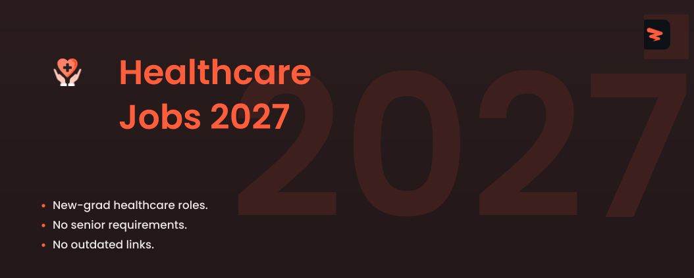

<!-- Cover -->

# Healthcare Jobs 2027

🚀 Healthcare and nursing jobs for new graduates, updated every 10 minutes.

  
  
  
  

---

## **Website & Autofill Extension**

Explore Zapply's website and check out:

- Our Chrome extension, which autofills job applications in seconds.
- A dedicated job board featuring the latest openings across various roles.
- User accounts with multiple profiles for different resume types and roles.
- Job application tracking with streaks and commitment awards.

Experience an advanced career journey with us! 🚀

  

## Explore Around

Connect and seek advice from a growing network of fellow students and new grads.

  
  &nbsp;&nbsp;
  

---

 

<h3>🏥 <strong>Nursing</strong></h3>

| Company | Role | Location | Posted | **Apply** |
|---------|------|----------|--------|----------|
| **Fresenius Medical Care** | Registered Nurse - RN - Dialysis | AZ101 BMA Flagstaff JV - Clinic | 13m |  |
| **Fresenius Medical Care** | Patient Care Technician - PCT | Lima, OH, USA | 13m |  |
| **Fresenius Medical Care** | Outpatient Registered Nurse- RN | Lockhart, TX | 13m |  |
| **University of Texas at Austin** | Registered Nurse (RN), Primary Care | AUSTIN, TX | 13m |  |
| **Highmark Health** | RN Outpatient - Pulmonary - West Penn - Full Time (Hybrid) | Pittsburgh PA, 15224 | 13m |  |
| **Highmark Health** | RN Ortho/Stroke/Trauma (NIGHTS), Forbes Hospital | Monroeville PA, 15146, 2570... | 13m |  |
| **Highmark Health** | RN Behavioral Health Unit, Forbes Hospital | Monroeville PA, 15146, 2570... | 13m |  |
| **LabCorp** | Casual/PRN Float Phlebotomist | Olympia WA | 23m |  |
| **AstraZeneca** | Early Oncology Clinical Development Intern, PharmD and PhD | Gaithersburg - MD | 23m |  |
| **Boys Town** | Registered Nurse Pediatrics | Omaha, NE | 33m |  |
| **Elevance Health** | LTSS Service Coordinator - RN Clinician (Hudson County, NJ) | 4 Locations | 34m |  |
| **Elevance Health** | Registered Nurse (PRN) – Paragon Infusion Centers | MO-KANSAS CITY, 8432 | 34m |  |
| **Cardinal Health** | PRN Hospital Pharmacy Technician | Enola- PAM Health Rehab Hosp of... | 43m |  |
| **NREL** | Postdoctoral Researcher in Scientific Machine Learning and Cross-scale Predictive Modeling | Golden, CO | 53m |  |
| **CVS Health** | Foreign Pharmacy Grad - International Pharmacy Intern | OH - Ravenna | 1h |  |
| **AstraZeneca** | US Medical Affairs, Real-World Evidence Hematology Intern | Gaithersburg - MD | 1h |  |
| **AstraZeneca** | US Medical Affairs, Tumor Drivers & Resistance Intern | Gaithersburg - MD | 1h |  |
| **CVS Health** | Pharmacy Intern | NC - Morrisville | 1h |  |
| **CVS Health** | Foreign Pharmacy Grad - International Pharmacy Intern | OH - Wooster | 1h |  |
| **Kroger** | PHARMACIST INTERN | Las Vegas, NV, United States | 23h |  |
| **University of Miami** | Registered Nurse 2 - Oncology Specialty, Full Time | Miami, Florida | 23h |  |
| **University of Miami** | Registered Nurse 2 - PACU -  UHealth SoLé Mia - Per Diem | North Miami, Florida | 23h |  |
| **Ascension** | Registered Nurse PACU Recovery | Nashville, TN | 23h |  |
| **Ascension** | Interventional Registered Nurse | Milwaukee, WI | 23h |  |
| **Ascension** | Registered Nurse Critical Care | Nashville, TN | 23h |  |
| **Tenet Healthcare** | RN Emergency Dept ED RN Travel and Local contract Rock Hill SC | Piedmont, SC, United States | 23h |  |
| **Tenet Healthcare** | Registered Nurse (RN) - OR | Goodyear, AZ, United States | 23h |  |
| **Tenet Healthcare** | Registered Nurse (RN) - Cardiac Tele | Delray Beach, FL, United States | 23h |  |
| **Albertsons** | PT Pharmacy Technician-Smyrna, DE | Smyrna, DE, United States | 23h |  |
| **Atlantic Health System** | Administrative Assistant - Per Diem, 7am-7pm, Nursing Resource, Atlantic Health Chilton Medical... | Pompton Plains, NJ, United States | 23h |  |
| **Atlantic Health System** | Patient Care Technician I - Full Time, Days 7a-7p, Emergency Department, Atlantic Health... | Summit, NJ, United States | 23h |  |
| **Atlantic Health System** | Registered Nurse, Full Time Nights, 7p -7a, Davino 1 Orthopedics/Med-Surg, Atlantic Health,... | Morristown, NJ, United States | 23h |  |
| **University of Miami** | Administrator in Charge, Nursing — Part-Time | Miami, Florida | 23h |  |
| **Zoetis** | Environment Health and Safety Intern | Kalamazoo - Downtown Portage Street | 1d |  |
| **Centene** | LPC, LCSW, or Psychiatric RN, Behavioral Health Service Care Manager | Corpus Christi Texas78414 | 1d |  |
| **LabCorp** | Histotechnologist PRN | Lakewood CO | 3d |  |
| **Centene** | LPC, LCSW, or Behavioral Health RN - Pediatrics | Austin Texas78712 | 3d |  |
| **Elevance Health** | Family Care-Registered Nurse | 24 Locations | 3d |  |
| **Wash U** | JR98428 Clinical Nurse Coordinator - Radiology (Breast Imaging) - Hybrid | Washington University Medical | 3d |  |
| **Cardinal Health** | PRN Pharmacy Technician | Roosevelt, NY | 3d |  |
| **University System of New Hampshire** | Adjunct EMT Skills Lab Learning Assistant | University of New Hampshire – Main | 3d |  |
| **Wash U** | RN Research Nurse Coordinator II (Hybrid) - Neurology | Washington University Medical | 3d |  |
| **Wash U** | RN Research Nurse Coordinator II - Cardiology | Washington University Medical | 3d |  |
| **Cigna** | LPN - Bilingual - Evernorth - Dalton GA | Dalton, GA | 3d |  |
| **Amgen** | Grad Intern – Global Medical Affairs Oncology (Summer 2027) | United States - Remote | 3d |  |
| **Globus Medical** | Neurophysiologist (Melbourne, FL) | Florida | 3d |  |
| **LabCorp** | Specimen Processor - PRN- 2nd Shift | Lakewood CO | 3d |  |
| **Kroger** | Pharmacy Intern | Seattle, WA, United States | 3d |  |
| **Kroger** | Pharmacy Intern | Shoreline, WA, United States | 3d |  |
| **Albertsons** | Starbucks Manager -0225KS-NP-294619 | Port Orchard, WA, United States | 3d |  |
| **Medtronic** | Clinical Specialist, Peripheral Nerve Stimulation (PNS) - Northern Manhattan, NY | Manhattan, New York, United... | 4d |  |
| **Cardinal Health** | PRN Physician | Largo, FL | 4d |  |
| **Cigna** | Health and Clinical Outcomes Research Intern (Master's/PhD Students) | Bloomfield, CT | 4d |  |
| **Cigna** | RN Onsite Health Coach | Clinic - Stanley Black & Decker | 4d |  |
| **Amgen** | Undergraduate Intern-R&D -Oncology Research (Summer 2027) | California - South San Francisco | 4d |  |
| **General Motors** | Registered Nurse - Occupational Health - PRN/per diem | Roanoke, Indiana, United States... | 5d |  |
| **Boys Town** | Advanced Practice RN-Pediatric Surgery Clinic-Full Time | Omaha, NE | 5d |  |
| **Boys Town** | Advanced Practice RN - Pediatric Surgery Clinic- Part Time | Omaha, NE | 5d |  |
| **Becton Dickinson** | Clinical Specialist (Vascular Access RN) - Central Florida/Lakeland /Gainesville | Florida FIELD | 5d |  |
| **Merck & Co.** | 2027 Future Talent Program - Global Medical Affairs - Intern | USA - Pennsylvania - North Wales | 5d |  |
| **Amgen** | Medical Science Liaison - Bone Health - IN, Southern IL | Indiana - Indianapolis | 5d |  |
| **Johnson & Johnson** | Oncology TR Scientist Intern | Spring House, Pennsylvania,... | 5d |  |
| **Eurofins** | Laboratory Technician I (M-F, 3pm -11:30pm) Eurofins Environment Testing Northern California -... | Folsom, CA | 5d |  |
| **Argonne National Laboratory** | Postdoctoral Appointee - Federated Learning and Foundation Model | Lemont, IL USA | 6d |  |
| **Conagra Brands** | PRN Nurse (LPN – Occupational Health) | Russellville, Arkansas | 6d |  |
| **Thermo Fisher Scientific** | Scientist – LNP Formulation | Boston, Massachusetts, USA | 6d |  |
| **Johnson & Johnson** | Oncology Discovery Scientist Intern | Spring House, Pennsylvania,... | 6d |  |
| **Johnson & Johnson** | Oncology Clinical Scientist Intern | Spring House, Pennsylvania,... | 6d |  |
| **Bristol Myers Squibb** | Patient Safety Intern Summer 2027 | Princeton NJ US | 6d |  |
| **Flagler Health** | Onsite - Medical Assistant (MA) / Licensed Practical Nurse (LPN) / Licensed Vocational Nurse (LVN) | 200 W Monroe St, 2nd Floor,... | 6d |  |
| **Flagler Health** | Onsite - Medical Assistant (MA) / Licensed Practical Nurse (LPN) / Licensed Vocational Nurse (LVN) | FLORIDA  Flagler Medical, P.C.... | 6d |  |
| **Flagler Health** | Onsite - Medical Assistant (MA) / Licensed Practical Nurse (LPN) / Licensed Vocational Nurse (LVN) | 2021 Guadalupe Street, Suite... | 6d |  |
| **Conagra Brands** | Nurse LPN - PRN 3rd shift | Council Bluffs, Iowa | 1w |  |
| **Bristol Myers Squibb** | Oncology Discovery Research Intern | Cambridge Crossing MA US | 1w |  |
| **LLNL** | Physics-Informed Machine Learning - Postdoctoral Researcher | Livermore, CA | 1w |  |
| **University of Texas at Austin** | Pre/Post Op Registered Nurse (RN) | AUSTIN, TX | 1w |  |
| **University of Texas at Austin** | Maternal Fetal Medicine Ultrasound Technologist | AUSTIN, TX | 1w |  |
| **Bristol Myers Squibb** | Clinical Flow Cytometry Intern | Princeton - NJ - US | 1w |  |
| **MedVet** | Nursing & ICU Veterinary Technician | South Salt Lake, Utah | 1w |  |
| **Abbott** | Registered Nurse - Patient Educator (PRN) Immediate Openings - Cape Girardeau, MO | United States - Missouri - Cape... | 1w |  |
| **MedVet** | Internal Medicine Veterinary Assistant - Part Time | Cincinnati, Ohio | 1w |  |
| **AbbVie** | Project Manager, New Product Introduction (NPI) | North Chicago, IL | 1w |  |
| **Wellmark, Inc.** | Payment Policy Analyst - Clinical (LPN or RN required) | Des Moines, IA | 1w |  |
| **Intuitive** | Health Economics & Outcomes Research (HEOR) Intern | Sunnyvale, CA | 1w |  |
| **Hormel Foods** | Veterinary Services Intern-Willmar, MN | Willmar, MN, United States | 1w |  |
| **MedVet** | Nursing & ICU Veterinary Technician | Akron, Ohio | 1w |  |
| **Guidehouse** | Inpatient Pediatric Medical Coder | Remote | 1w |  |
| **Abbott** | Registered Nurse - Patient Educator (PRN) Immediate Openings - Bronx, NY; Levittown, NY; Medford, NY | United States - New York - Brooklyn | 1w |  |
| **Gilead Sciences** | Senior Associate Scientist, External Quality Analytical Oversight | United States - California -... | 1w |  |
| **LLNL** | Machine Learning - Postdoctoral Researcher | Livermore, CA | 1w |  |
| **LLNL** | Sidney Fernbach Postdoctoral Fellow | Livermore, CA | 1w |  |
| **Intuitive** | Clinical Scientist Intern | Sunnyvale, CA | 2w |  |
| **Elanco** | R&D Veterinary Services Intern - Fort Dodge, IA (Summer 2027) | Fort Dodge, IA | 3w |  |
| **Zoetis** | Endoparasite Biologist Intern | Kalamazoo - Downtown Portage Street | 3w |  |
| **HP Inc** | Chemical Engineer / Chemist Postdoctoral Intern | Corvallis, Oregon, United... | 3w |  |
| **Merck & Co.** | 2027 Future Talent Program - Global Lung Medical Affairs - Intern | New Jersey Rahway | 3w |  |
| **HNTB** | New Grad Scientist I - Summer 2027 - Central Division (For Current/Returning HNTB Interns Only) | Dallas, TX | 1mo |  |
| **Stryker** | Summer 2027 Internship - Statistical Programming - California | Irvine, California | 1mo |  |
| **Stryker** | Summer 2027 Internship - Clinical Affairs - New Jersey | Mahwah, New Jersey | 1mo |  |
| **Stryker** | Summer 2027 Internship - Clinical Affairs - Michigan | Portage, Michigan | 1mo |  |

Apply for more jobs at

<h3>🔬 <strong>Research & Laboratory</strong></h3>

| Company | Role | Location | Posted | **Apply** |
|---------|------|----------|--------|----------|
| **University of Texas at Austin** | Clinical Research Operations Analyst II | AUSTIN, TX | 13m |  |
| **Intel** | Analytical Chemistry Lab Technician | US, Oregon, Hillsboro | 23m |  |
| **LabCorp** | Laboratory Assistant - Full Time- 2nd Shift-Chemistry | Tulsa OK | 23m |  |
| **LabCorp** | Clinical Laboratory Technologist - Special Chemistry | Burlington NC | 23m |  |
| **LabCorp** | Clinical Laboratory Technician | Kingsport TN | 23m |  |
| **Zoetis** | Laboratory Technician - Virus Operations 1st Shift 7:15am - 3:45pm | Lincoln | 23m |  |
| **Zoetis** | Laboratory Technician - Virus Operations 1st Shift 7:15am - 3:45pm | Lincoln | 23m |  |
| **AstraZeneca** | Associate Scientist | Gaithersburg - MD | 23m |  |
| **Northeastern University** | Postdoctoral Research Associate - Digital Health and Precision Symptom Science – Oncology Focus | Boston, MA | 32m |  |
| **Northeastern University** | Postdoctoral Research Associate | Boston, MA | 32m |  |
| **Thermo Fisher Scientific** | Chromatography Scientist - Multiple Shifts Available | Richmond, Virginia, USA | 33m |  |
| **GDIT** | Clinical Research Coordinator (CRC) | USA NC Fort Bragg | 34m |  |
| **Aerospace Corporation** | 2026 Plasma Science Research Associate | El Segundo, CA | 34m |  |
| **Aerospace Corporation** | 2027 Research Associate - Space Photovoltaic Hardware/Device Testing | El Segundo, CA | 34m |  |
| **Aerospace Corporation** | 2027 Semiconductor Test Research Associate | El Segundo, CA | 34m |  |
| **Cardinal Health** | Lab Technician (Nights) | East Rutherford PET, NJ | 43m |  |
| **Carnegie Mellon University** | Postdoctoral Research Associate - College of Engineering - Department of Mechanical Engineering | Pittsburgh, PA | 53m |  |
| **Amgen** | Medical Science Liaison - Uncontrolled Gout - Rare Disease - MI | Michigan - Detroit | 54m |  |
| **Amgen** | Medical Science Liaison - Obesity and Related Conditions - IA, NE, SD | Nebraska Omaha | 54m |  |
| **Danaher** | Scientist I Production Operations | Chaska, Minnesota, United States | 1h |  |
| **Fresenius Medical Care** | Clinical Research Coordinator | Kalamazoo, MI, USA | 1h |  |
| **Bristol Myers Squibb** | Associate Scientist | New Brunswick - NJ - US | 1h |  |
| **Abbott** | Clinical Research Scientist | United States - Minnesota -... | 2h |  |
| **Johnson & Johnson** | Medical Science Liaison - Hematology - Boston, MA | Boston, Massachusetts, United... | 4h |  |
| **Eurofins** | Laboratory Technician - Rapid Microbiology (Grand Island, NE Day-Shift) | Grand Island, NE | 5h |  |
| **AbbVie** | Associate Scientist II - Formulation | North Chicago, IL | 6h |  |
| **Iterative Health** | Clinical Research Coordinator II - Chesterfield, VA | Chesterfield, Virginia | 8h |  |
| **Eurofins** | R&D Laboratory Technician | Davis, CA | 9h |  |
| **Amazon.com Services LLC** | Data Scientist I, NEST | Bellevue, WA | 23h |  |
| **Danaher** | Scientist I Production Operations | Chaska, Minnesota | 23h |  |
| **Gilead Sciences** | Scientist, Process Development | United States - California -... | 2d |  |
| **Eurofins** | Laboratory Technician l (Full-Time) | Louisville, KY | 2d |  |
| **Thermo Fisher Scientific** | Scientist I, Analytical Research & Development | Florence, South Carolina, USA | 3d |  |
| **Thermo Fisher Scientific** | QC Scientist II - Microbiology | Greenville, North Carolina, USA | 3d |  |
| **Cardinal Health** | Lab Technician | Birmingham PET, AL | 3d |  |
| **Carnegie Mellon University** | Postdoctoral Research Associate - College of Engineering - Department of Mechanical Engineering | Pittsburgh, PA | 3d |  |
| **Wash U** | Clinical Research Coordinator II - Obstetrics and Gynecology | Washington University Medical | 3d |  |
| **Amgen** | Medical Science Liaison - Bone Health - VA, WV | Virginia Richmond | 3d |  |
| **BorgWarner** | Measurement Lab Technician (Industrial Solutions) - Grade F ($26.52 - $31.83) | Hendersonville - North Carolina... | 3d |  |
| **AbbVie** | Scientist II, Fermentation Process Development – Recombinant Peptides | Irvine, CA | 3d |  |
| **Profluent** | Scientist II, Molecular Function | Emeryville, California, United... | 3d |  |
| **Convergent Research** | E11 Bio - Scientist I/II, Expansion Microscopy | Alameda, California | 3d |  |
| **Mariana Minerals** | Lab Technician | Moab, UT | 3d |  |
| **Pfizer** | Senior Associate Scientist, ADC In Vivo Pharmacology | United States - California -... | 3d |  |
| **Iterative Health** | Clinical Research Coordinator II - Tacoma WA | Tacoma, Washington | 3d |  |
| **ALTEN Technology** | Robotics Lab Technician | North Reading, MA | 3d |  |
| **Tenet Healthcare** | Medical Lab Scientist (MLS) | El Paso, TX, United States | 3d |  |
| **Tenet Healthcare** | Clinical Lab Scientist (CLS) | Manteca, CA, United States | 3d |  |
| **Campbell Soup Company** | Scientist I - Sensory - Meals and Beverage | USA - NJ - Camden | 4d |  |
| **Highmark Health** | Clinical Research Nurse - AHN Hematology, Cellular Therapy and Investigator Initiated Studies -... | Pittsburgh PA, 15224, West Penn... | 4d |  |
| **Dexcom** | Lab Technician 2 (  2A Sunday -Tuesday every other Saturday 4pm-4am ) | Mesa, Arizona | 4d |  |
| **Zoetis** | Laboratory Technician - Virus Operations 1st Shift 7:15am - 3:45pm | Lincoln | 4d |  |
| **Northeastern University** | Postdoctoral Research Associate | Boston, MA | 4d |  |
| **Bio-Techne** | Advanced Research Associate, Spatial Biology | Newark, CA | 4d |  |
| **Pfizer** | Sr. Associate Scientist | United States - Washington –... | 4d |  |
| **Merck & Co.** | Associate Scientist, Postdoctoral Research Fellow - Translational Imaging | USA - California - South San... | 4d |  |
| **Cardinal Health** | Laboratory Technician | Fort Lauderdale PET, FL | 4d |  |
| **Baxter International** | Quality Lab Technician I | Marion, North Carolina | 4d |  |
| **University System of New Hampshire** | Postdoctoral Research Associate | University of New Hampshire – Main | 4d |  |
| **Wash U** | Clinical Research Data Assistant - Biliary/Gastroenterology | Washington University Medical | 4d |  |
| **Wash U** | Clinical Research Coordinator II - Pulmonary & Critical Care Medicine | Washington University Medical | 4d |  |
| **General Mills** | FSQ Lab Technician - Blue Buffalo | Joplin, MO | 4d |  |
| **General Mills** | Food Safety and Quality Lab Technician - 2nd Shift - Cedar Rapids Plant | Cedar Rapids, IA | 4d |  |
| **Momentive** | Research Associate Lab Technician | NY Pearl River | 4d |  |
| **Gilead Sciences** | Scientist, Process Development | United States - California -... | 4d |  |
| **Gilead Sciences** | Lab Technician II (Night Shift) | United States - California -... | 4d |  |
| **AstraZeneca** | Medical Science Liaison -(Immunology) - Arizona/New Mexico/West Texas | Phoenix, AZ | 4d |  |
| **Abbott** | Clinical Laboratory Scientist I | United States - Wisconsin -... | 4d |  |
| **Abbott** | Clinical Laboratory Scientist I - Weekend PM | United States > Madison : 650... | 4d |  |
| **Flagship Pioneering** | Senior Research Associate / Associate Scientist, Nonclinical | Cambridge, MA USA | 4d |  |
| **Atlantic Health System** | Medical Laboratory Scientist, Per Diem, Microbiology, ACL, Morristown, NJ | Morristown, NJ, United States | 4d |  |
| **Hologic** | Clinical Research Associate 2 | San Diego, CA, United States | 4d |  |
| **Hologic** | Clinical Research Associate 1 | San Diego, CA, United States | 4d |  |
| **Fresenius Medical Care** | Clinical Educator | CA137 Kearny Mesa JV - Clinic | 5d |  |
| **Fresenius Medical Care** | Clinical Educator | CA061 Chula Vista South - Clinic | 5d |  |
| **HPE (University)** | Hardware Lab Technician VI | Sunnyvale, California, United... | 5d |  |
| **Boeing** | Associate Test & Evaluation Lab Technician (Test Operation) | USA - Berkeley, MO | 5d |  |
| **Pfizer** | Associate Scientist | United States - New York -... | 5d |  |
| **Merck & Co.** | Associate Scientist, Chemical Engineering Research & Development (Onsite) | USA - New Jersey - Rahway | 5d |  |
| **Merck & Co.** | Scientist, Analytical R&D (2nd Shift) | USA - New Jersey - Rahway | 5d |  |
| **HPE** | Hardware Lab Technician VI | Sunnyvale, California, United... | 5d |  |
| **Envista Holdings** | Optical Lab Technician | WI | 5d |  |
| **Danaher** | Research associate: B-cell Sorting and Reagent operations | Waltham, Massachusetts, United... | 5d |  |
| **Booz Allen Hamilton** | C5 Laboratory Technician | Suffolk, VA | 5d |  |
| **Iterative Health** | Clinical Research Coordinator I - Albany, NY | Albany, NY | 5d |  |
| **AbbVie** | Scientist I | Waltham, MA | 5d |  |
| **Nokia** | R&D lab technician | United States | 5d |  |
| **Tenet Healthcare** | Medical Lab Scientist (MLS) | West Palm Beach, FL, United States | 5d |  |
| **Atlantic Health System** | Medical Laboratory Scientist, Full Time Days, Point of Care, Morristown, NJ | Morristown, NJ, United States | 5d |  |
| **Ascension** | Clinical Research Coordinator | Milwaukee, WI | 5d |  |
| **HPE (University)** | HPE Labs - Postdoctoral Research Associate: Optical Switching Hardware Simulation for HPC | Milpitas, California, United... | 6d |  |
| **Guidehouse** | Data Scientist II | PA, Mechanicsburg | 6d |  |
| **Guidehouse** | Clinical Research Coordinator | MD, Bethesda | 6d |  |
| **Guidehouse** | Clinical Research Coordinator | MD, Bethesda | 6d |  |
| **Becton Dickinson** | QC Lab Technician II | USA NC - Mebane | 6d |  |
| **AstraZeneca** | Immunology Associate Medical Science Liaison (KS, OK, MO) | Kansas City, MO | 6d |  |
| **Philips** | Clinical Scientist – Computed Tomography (Orange, OH) | Orange OH Ohio United States | 6d |  |
| **Chan Zuckerberg Biohub** | Postdoctoral Fellow/ Scientist I, T Cell Biology and Tissue Immunology | New York, NY (Onsite) | 6d |  |
| **Amazon Development Center U.S., Inc.** | Applied Scientist II, Kiro Science | Santa Clara, CA | 6d |  |
| **Atlantic Health System** | Medical Laboratory Scientist, Part Time Evenings, Blood Bank, Summit, NJ | Summit, NJ, United States | 6d |  |

Apply for more jobs at

<h3>💼 <strong>Business & Operations</strong></h3>

| Company | Role | Location | Posted | **Apply** |
|---------|------|----------|--------|----------|
| **Highmark Health** | Respiratory Therapist | Grove City PA, 16127, 631 N... | 13m |  |
| **Stryker** | Clinical Specialist, Enabling Technologies (NYC) | New York, New York | 22m |  |
| **Medtronic** | Clinical Specialist, Cranial & Spinal Technologies - Charlottesville, VA | Charlottesville, Virginia,... | 22m |  |
| **Medtronic** | Clinical Specialist, Neurovascular - Georgia | Atlanta, Georgia, United States... | 22m |  |
| **Medtronic** | Prin. Vascular Clinical Specialist - Milwaukee, WI / Green Bay, WI | Milwaukee, Wisconsin, United... | 22m |  |
| **Guidehouse** | Cash Poster - Payment Posting - Hospital Claims | CA, El Segundo | 23m |  |
| **Guidehouse** | Patient Account Representative - Physician Claims | TX Lewisville | 23m |  |
| **Boys Town** | Behavioral Health Tech | Omaha, NE | 33m |  |
| **CVS Health** | Behavioral Health Network Relations Manager – Louisiana | Field Louisiana | 5h |  |
| **CVS Health** | Prior Authorization UM Nurse Consultant | LA - Work from home | 5h |  |
| **Ascension** | Behavioral Health Case Manager | Hoffman Estates, IL | 23h |  |
| **Tenet Healthcare** | Respiratory Therapist | San Antonio, TX, United States | 23h |  |
| **Tenet Healthcare** | Behavioral Health Counselor | Worcester, MA, United States | 23h |  |
| **Tenet Healthcare** | Behavioral Health Tech | Tucson, AZ, United States | 23h |  |
| **Ascension** | Radiation Therapist | Elk Grove Village, IL | 23h |  |
| **Ascension** | Physical Therapist | Baltimore, MD | 23h |  |
| **Atlantic Health System** | Behavioral Health Clinician - (LPC/LCSW) - Full Time - Days - Shift Varies - M-F - Atlantic... | Summit, NJ, United States | 23h |  |
| **University of Miami** | Patient Access Representative 3 (On-Site) (H) | Doral, Florida | 23h |  |
| **Atlantic Health System** | Occupational Therapist I: Per Diem, Variable Days w/2 Wknd Days/mo., Atlantic Health Morristown... | Morristown, NJ, United States | 23h |  |
| **CVS Health** | Customer Service Representative - Behavioral Health | NC Work from home | 2d |  |
| **Highmark Health** | Patient Access Coordinator II/Registration - AHN Fed North - Full time - Rotating Shifts | Pittsburgh PA, 15212 | 3d |  |
| **Highmark Health** | Patient Access Coordinator - AHN Cardiovascular Clinic - Erie - Full Time | Erie PA, 16502 | 3d |  |
| **Guidehouse** | Hospital Admissions Rep - Varied Night Shift,  Part Time, Onsite | CA, Los Angeles | 3d |  |
| **Becton Dickinson** | Clinical Specialist - Raleigh, NC | GA Covington BMD | 3d |  |
| **Elevance Health** | Respiratory Therapist | 6 Locations | 3d |  |
| **Amgen** | Field Medical Onboarding & Capability Development, US FME | United States - Remote | 3d |  |
| **Stryker** | Clinical Specialist, Joint Replacement - Fort Wayne, IN | Fort Wayne, Indiana | 3d |  |
| **Stryker** | Clinical Specialist- Columbus, Ohio- Neurovascular | Columbus, Ohio | 3d |  |
| **Abbott** | Clinical Specialist, Cardiac Rhythm Management - Long Island, NY | United States - New York - Long... | 3d |  |
| **Abbott** | Clinical Specialist II | United States - Florida - Fort... | 3d |  |
| **Abbott** | Clinical Specialist, Post Market Surveillance | United States - Massachusetts -... | 3d |  |
| **Boston Scientific** | Clinical Specialist   Urology - Sacral Neuromodulation   Cincinnati, OH | Cincinnati US-OH, United States... | 3d |  |
| **Boston Scientific** | Clinical Specialist   Urology - Sacral Neuromodulation   Evansville, IN | Evansville US-IN, United States... | 3d |  |
| **Boston Scientific** | Clinical Specialist II, SCS - Phoenix, AZ | Phoenix US-AZ, United States   N/A | 3d |  |
| **Hilton** | Massage Therapist | Deerfield Beach, FL, United States | 3d |  |
| **University of Miami** | Patient Access Representative 3, Full Time | Miami, Florida | 3d |  |
| **University of Miami** | Patient Access Representative 1 (On-Site) - UHealth Primary Care - North Miami | Miami, Florida | 3d |  |
| **Elevance Health** | Behavioral Health Customer Care Representative I | PA-SEVEN FIELDS | 4d |  |
| **Leidos** | Military Family Life Counselor - MCBH | Marine Corps Base Kaneohe Bay, HI | 4d |  |
| **Atlantic Health System** | Behavioral Health Clinician, Full Time, Days, AMG Primary Care - Behavioral Health | NJ, United States | 4d |  |
| **Elevance Health** | Prior Authorization Pharmacy Technician II | 5 Locations | 5d |  |
| **Baxter International** | Acute Care Clinical Specialist, New England Territory) | New York, NY | 5d |  |
| **Wash U** | Clinical Specialist PT/OT (Hybird/Part-Time) - Neurology | Washington University Medical | 5d |  |
| **Philips** | Sales Support, Clinical Specialist - Cardiac Solutions Image Guided Therapy Devices (Boston, MA) | Boston, Massachusetts, United... | 5d |  |
| **Leidos** | Military Family Life Counselor -Youth | Coronado, CA | 5d |  |
| **Boys Town** | PRTF Therapist | Omaha, NE | 6d |  |
| **University System of New Hampshire** | Camp Counselor Barry Conservation 4H Camp | Cooperative Extension-Coos County | 6d |  |
| **Philips** | Sales Support, Clinical Specialist - Peripheral - Image Guided Therapy Devices (Dallas TX) | Dallas, Texas, United States | 6d |  |
| **EVERSANA** | Medical Information Specialist | Overland Park, KS | 6d |  |
| **Leidos** | Military Family Life School Counselor - JBER, AK | Jber, AK | 6d |  |
| **Hilton** | Massage Therapist (Part-Time) | New Orleans, LA, United States | 6d |  |
| **GDIT** | Mental Health Clinician | NC Fort Bragg | 1w |  |
| **GDIT** | Mental Health Technician | NC Fort Bragg | 1w |  |
| **GDIT** | Clinical Psychologist | USA NC Fort Bragg - Fort Bragg | 1w |  |
| **Baxter International** | Clinical Appeals Advocate | United States of America - Remote | 1w |  |
| **Hilton** | Massage Therapist (Part-Time) - Waldorf Astoria Orlando | Orlando, FL, United States | 1w |  |
| **Philips** | Sales Support, Clinical Specialist - Coronary Image Guided Therapy Devices (Indianapolis) | Indianapolis, Indiana, United... | 1w |  |
| **Becton Dickinson** | Clinical Specialist - Oklahoma City | USA - Oklahoma - Oklahoma City | 1w |  |
| **Becton Dickinson** | Clinical Specialist - Atlanta, GA | USA - Georgia - Atlanta | 1w |  |
| **Boys Town** | Psychiatric Technician | Omaha, NE | 1w |  |
| **University of Texas at Austin** | GeoFORCE Counselor (Female Floor) | PICKLE RESEARCH | 1w |  |
| **University of Texas at Austin** | GeoFORCE Counselor (Male Floor) | PICKLE RESEARCH | 1w |  |
| **SpaceX** | Environmental Health & Safety Specialist (Paramedic) | Long Beach, CA | 2w |  |
| **SpaceX** | Environmental Health & Safety Specialist (Paramedic) | Cape Canaveral, FL | 2026-09-03 |  |

Apply for more jobs at

<h3>⚕️ <strong>General Healthcare & Clinical</strong></h3>

| Company | Role | Location | Posted | **Apply** |
|---------|------|----------|--------|----------|
| **Argonne National Laboratory** | Postdoctoral Researcher – Advanced Material and Membrane Development for Water and Critical... | Lemont, IL USA | 13m |  |
| **Highmark Health** | Cardiac Monitor Technician - West Penn Hospital - Full Time | Pittsburgh PA, 15224, West Penn... | 13m |  |
| **Highmark Health** | Phlebotomy Trainee Program - Available at AGH, AVH and Forbes Hospital | Pittsburgh PA, 15212 | 13m |  |
| **Highmark Health** | Virtual Patient Monitor - Full Time - Night - 2 Allegheny Center Pittsburgh | Pittsburgh PA, 15212, 2 Allegheny | 13m |  |
| **CVS Health** | Pharmacy Technician | AL - Decatur | 13m |  |
| **CVS Health** | Pharmacy Technician | TX - Pantego | 13m |  |
| **CVS Health** | Pharmacy Technician | TX - Keller | 13m |  |
| **ICF** | Sustainable Mobility Specialist (Entry Level, Summer 2027, Remote - New York) | Long Island | 14m |  |
| **LabCorp** | Phlebotomist | Maple Valley WA | 14m |  |
| **LabCorp** | Phlebotomy Trainee | Issaquah WA | 14m |  |
| **LabCorp** | Phlebotomist | Tacoma WA | 14m |  |
| **Pfizer** | DSRD Necropsy and Histology Technician | United States - Connecticut -... | 23m |  |
| **AstraZeneca** | Process Engineer, Cell Therapy Process Development | Gaithersburg - MD | 23m |  |
| **Boys Town** | Patient Access Specialist | Council Bluffs, IA | 33m |  |
| **Boys Town** | Healthcare Compliance Nurse (Part-Time) | Omaha, NE | 33m |  |
| **Merck & Co.** | Associate Specialist, Engineering - 2nd Shift (Onsite) | USA - New Jersey - Rahway | 33m |  |
| **Thermo Fisher Scientific** | Assoc. Manager, Clinical Operations - FSP | Remote, California, USA | 33m |  |
| **Aerospace Corporation** | 2027 Cleanroom & Device Test Associate | El Segundo, CA | 34m |  |
| **Aerospace Corporation** | Electromechanical Technician | El Segundo, CA | 34m |  |
| **Aerospace Corporation** | Electronics Technology Specialist PMP | El Segundo, CA | 34m |  |
| **Elevance Health** | Telephonic Nurse Case Manager I | 2 Locations | 34m |  |
| **Elevance Health** | Nurse Case Manager II | KY-LOUISVILLE | 34m |  |
| **Elevance Health** | Outreach Care Specialist | 5 Locations | 34m |  |
| **Wash U** | Medical Assistant III - Rheumatology | Washington University Medical | 42m |  |
| **Wash U** | Medical Assistant II (Siteman South) - Medical Oncology | South County - St. Louis, MO | 42m |  |
| **Wash U** | Medical Assistant II (South County) - Faculty Practice Plan | South County - St. Louis, MO | 42m |  |
| **Cardinal Health** | Nuclear Pharmacy Technician | Southfield, MI | 43m |  |
| **Cardinal Health** | Pharmacy Technician | New Orleans, LA | 43m |  |
| **Cardinal Health** | Nuclear Pharmacy Technician | Wichita, KS | 43m |  |
| **Baxter International** | Territory Business Manager, Advanced Surgery - South Seattle WA | Seattle, WA | 43m |  |
| **Elanco** | Senior Associate - Clinical Development Sciences | Fort Dodge, IA | 44m |  |
| **Abbott** | Clinical Associate | United States - North Carolina... | 53m |  |
| **Abbott** | Clinical Lab Associate IV - 2nd Shift | United States > Madison : 650... | 53m |  |
| **NREL** | Postdoctoral Researcher in Numerical Optimization and Experimental Design | Golden, CO | 53m |  |
| **NREL** | Postdoctoral Researcher in uncertainty quantification and prediction reliability | Golden, CO | 53m |  |
| **Bristol Myers Squibb** | Patient Access Support Services, Enterprise Access & Reimbursement Manager - Orlando, FL... | Orlando - FL - US | 54m |  |
| **Globus Medical** | Neurophysiologist (Austin, TX)   Sign-On Bonus for CNIM! | Texas | 1h |  |
| **Intuitive** | da Vinci Specialist | Fresno, CA | 1h |  |
| **Stryker** | Marketing Associate- Surgical Technologies | Portage, Michigan | 1h |  |
| **Fresenius Medical Care** | Registered Dietitian | AZ055 BMA Estrella JV Clinic | 1h |  |
| **Fresenius Medical Care** | Clinic Administrative Assistant | Medford, MA | 1h |  |
| **Fresenius Medical Care** | Registered Dietitian | Rocky Mount, NC | 1h |  |
| **AstraZeneca** | Oncology Account Specialist- Lung Cancer -  St. Louis, MO | St Louis - MO | 1h |  |
| **CACI** | PC Imaging Technician | National Harbor MD US | 1h |  |
| **Intuitive** | da Vinci Specialist | Brooklyn, NY | 1h |  |
| **AbbVie** | Field Reimbursement Manager | Kansas City, KS | 1h |  |
| **AbbVie** | Clinical Sciences Partnership COE Coordinator - Hybrid, Chicago | North Chicago, IL | 1h |  |
| **AbbVie** | Manager, Portfolio Program Planning | North Chicago, IL | 1h |  |
| **Eurofins** | Laboratory Supervisor | New Orleans, LA | 2h |  |
| **Intuitive** | da Vinci Specialist | Virginia Beach, VA | 3h |  |
| **Abridge** | Clinical Success Manager - Federal | United States - Remote | 4h |  |
| **Eurofins** | Day Cleaner - Logistic | Redmond, WA | 5h |  |
| **Eurofins** | Cytotechnologist | Carmel, IN | 8h |  |
| **Rackner** | Clinical Applications Trainer — Federal Health IT | Remote — United States | 9h |  |
| **Kroger** | Patient Care Tech | Franklin, TN, United States | 23h |  |
| **Kroger** | Certified Pharmacy Technician | Midlothian, VA, United States | 23h |  |
| **Kroger** | PHARMACY/PHARMCST-STUDENT | Menomonee Falls, WI, United States | 23h |  |
| **University of Miami** | Central Sterile Processing Technician, Part Time | Miami, Florida | 23h |  |
| **University of Miami** | Patient Access Associate (On-Site) (H) | Coral Gables, Florida | 23h |  |
| **Ascension** | Certified Medical Assistant Cardiology | Nashville, TN | 23h |  |
| **Ascension** | Radiology Tech | Milwaukee, WI | 23h |  |
| **Ascension** | Certified Surgical Tech | Austin, TX | 23h |  |
| **Tenet Healthcare** | Certified Occupational Therapy Assistant - Pediatrics | San Antonio, TX, United States | 23h |  |
| **Tenet Healthcare** | Licensed Physical Therapy Assistant | Delray Beach, FL, United States | 23h |  |
| **Tenet Healthcare** | Unit Support Tech - Step Down | Delray Beach, FL, United States | 23h |  |
| **Albertsons** | Pharmacy Technician | Long Beach, CA, United States | 23h |  |
| **Albertsons** | Pharmacy Technician | Countryside, IL, United States | 23h |  |
| **Albertsons** | Pharmacy Technician | Colleyville, TX, United States | 23h |  |
| **Atlantic Health System** | Unit Associate I - Full Time, Evenings 3pm-11pm, Gagnon 5 Non-Invasive Cardiac, Atlantic Health... | Morristown, NJ, United States | 23h |  |
| **Atlantic Health System** | Sterile Processing Technician - Full Time - Evenings - Atlantic Health Morristown Medical Center | Morristown, NJ, United States | 23h |  |
| **Atlantic Health System** | Unit Associate I, per diem days 7a-3p, Deskovick 3-Ortho/Spine, Atlantic Health Morristown... | Morristown, NJ, United States | 23h |  |
| **University of Miami** | Surgical Technologist 2 Per Diem Bascom Palmer Eye Institute Miami, FL | Miami, Florida | 23h |  |
| **Insulet Corporation** | Controls & Instrumentation Technician (12 Hour Nights Shift - Onsite) | Massachusetts | 2d |  |
| **Hologic** | Manager, Clinical Data and Systems | San Diego, CA, United States | 2d |  |
| **Argonne National Laboratory** | Postdoctoral Appointee – NST Superconducting Qubits for Quantum Sensing | Lemont, IL USA | 3d |  |
| **University of Texas at Austin** | Health Information Management Specialist | AUSTIN, TX | 3d |  |
| **USAA** | Life Insurance Sales Agent – Multi-Level Opportunity | Plano Legacy | 3d |  |
| **USAA** | Life Insurance Sales Agent – Multi-Level  Opportunity | Tampa Crosstown | 3d |  |
| **Boys Town** | Speech Language Pathologist | Omaha, NE | 3d |  |
| **Thermo Fisher Scientific** | FSP Associate Manager Project Delivery | Remote, North Carolina, USA | 3d |  |
| **Thermo Fisher Scientific** | Supervisor, Investigator Site Services | Covington, Kentucky - USA | 3d |  |
| **Pfizer** | Cardiovascular Specialist, Health and Science Professional - Boston,MA | United States - Massachusetts -... | 3d |  |
| **Pfizer** | DSRD Necropsy and Histology Technical Assistant | United States - Connecticut -... | 3d |  |
| **Baxter International** | Spec, Clinical Integration | United States of America - Remote | 3d |  |
| **Cigna** | Pharmacy Production Clerk , Express Scripts-1 | St. Louis, MO | 3d |  |
| **Cigna** | Clinical Account Executive - Express Scripts - Remote (Commercial) | St Louis, MO | 3d |  |
| **Cigna** | Home Infusion Nurse  - Accredo - Jacksonville, FL | Jacksonville, FL | 3d |  |
| **Amgen** | Patient Access Liaison - UPLIZNA - Minneapolis, MN | Minnesota - Minneapolis | 3d |  |
| **Amgen** | Patient Access Liaison - UPLIZNA - Mountain West | Washington - Seattle | 3d |  |
| **Amgen** | Patient Access Liaison - UPLIZNA- North Florida | Florida - West Palm Beach | 3d |  |
| **athenahealth** | US Service Operations Analyst | Belfast, ME | 3d |  |
| **AstraZeneca** | Associate Quality Control Quality Microbiology, Cell Therapy | Rockville - MD | 3d |  |
| **Abbott** | Clinical Associate | United States - Florida -... | 3d |  |
| **Syska Hennessy Group** | Plumbing Engineer II - IV/Designer II - IV - Healthcare | Washington D.C. | 3d |  |
| **Johnson & Johnson** | Oncology Scientific Publications Co-op | Raritan, New Jersey, United... | 3d |  |
| **Bristol Myers Squibb** | Associate, Quality Control, Cell Therapy | Bothell - WA - US | 3d |  |
| **Advantmed** | Remote - HEDIS Abstractors / HEDIS Reviewers | United States | 3d |  |
| **Campbell Soup Company** | Occupational Health Nurse | USA - IL - Downers Grove | 4d |  |
| **Zoetis** | QO Lab Analyst I-III | Kalamazoo - Portage Road | 4d |  |
| **Zoetis** | Veterinary Pathologist | Kalamazoo - Downtown Portage Street | 4d |  |

Apply for more jobs at

---

### Live Job Boards

  
  &nbsp;&nbsp;
  
  &nbsp;&nbsp;
  

  
  &nbsp;&nbsp;
  
  &nbsp;&nbsp;
  

  
  &nbsp;&nbsp;
  
  &nbsp;&nbsp;
  

  

### Curated Internships

  
  &nbsp;&nbsp;
  
  &nbsp;&nbsp;
  

  
  &nbsp;&nbsp;
  

### Career Resources

  
  &nbsp;&nbsp;
  

---

Add new jobs to our listings keeping in mind the following:

- Located in the US.
- Create a new issue to submit different job positions.
- Update a job by submitting an issue with the job URL and required changes.

Our team reviews within 24-48 hours and approved jobs are added to the main list!

Questions? Create a miscellaneous issue, and we'll assist! 🙏

**🎯 10597 current opportunities from 140 companies**

**Found this helpful? Give it a ⭐ to support Zapply!**

*Not affiliated with any companies listed. All applications redirect to official career pages.*

---

## Data & Reuse

Job listings are public information provided by employers, who remain responsible for their accuracy. The compilation and the added data fields (skills, degree and visa estimates, tags) are by Zapply.

You may use, share, and build on this data, including for commercial purposes, as long as you:

- Link back to this repository as the source (followed link, no nofollow).
- Credit Zapply as the data source.
- Do not resubmit the listings to third-party job aggregators or feeds.
- Do not present Zapply enrichment fields as official employer statements; they are automated estimates provided as-is, without warranty.

You may use the name Zapply to attribute the data. Please do not use the Zapply logo or imply endorsement without written permission.

Questions or a different use? Open an issue. We say yes more often than not.

---

**Last Updated**: November 9, 2026

